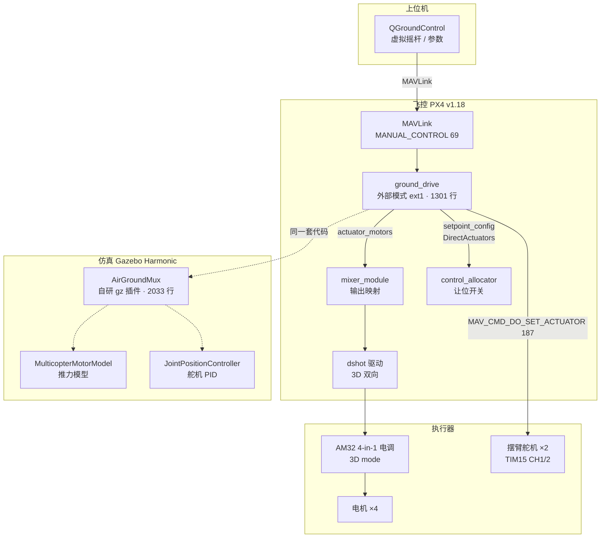

# 陆空两栖机器人 · 控制方法与系统实现

> **Air-Ground Amphibious Robot** —— 一套执行器同时驱动 **4 个螺旋桨**与 **4 个车轮**。
> 摆臂 0° 时桨朝上可飞行，摆臂 ~48° 时轮盘立起可地面行驶。
> 本项目完成 **URDF 建模 → Gazebo 物理仿真 → PX4 飞控移植 → 实机验证** 的全链路实现。

<p align="center">
  <b>约 17,000 行代码与文档 · 35 项独立实验 · 213 个技术小节</b>
</p>

---

## 目录

| 目录 | 内容 |
|:---|:---|
| [`docs/`](docs/) | 6 份技术文档（5700+ 行） |
| [`01-simulation/`](01-simulation/) | 仿真世界：URDF / SDF / mesh / Gazebo 插件 |
| [`02-flight-control/`](02-flight-control/) | 飞控命令代码：地面驱动模块 + airframe |
| [`03-tools/`](03-tools/) | 调试与自动化脚本（23 个 Python + 5 个 Shell） |
| [`04-experiments/`](04-experiments/) | **实验数据与日志**（35 项实验台账 + 实测数据表） |
| [`05-px4-modified/`](05-px4-modified/) | **修改后的 PX4 源码**（按原始路径组织 + patch） |
| [`06-qgc-actions/`](06-qgc-actions/) | QGroundControl 自定义动作（9 档摆臂角） |

---

## 一、核心贡献

### 突破一 · 仿真平台的可信度体系

不是「把模型跑起来」，而是建立 **四层保真度递进 + 每层可验证判据** 的数字孪生：

| 层级 | 内容 | 验证判据（实测） |
|:---|:---|:---|
| **L1 几何** | URDF 11 link，质量 0.6799 kg | 与实物称重对照 |
| **L2 接触** | mesh 碰撞体 → 3 box + 8 cylinder 代理 | 构建失败 **11 → 0 次**；静置 z = **0.0209996 m**（理论 0.021，误差 **0.4 µm**）|
| **L3 执行器** | `MulticopterMotorModel`，TWR 反推 kT = 4.325e-7 | 满油起飞 a = **17.76 m/s²**（理论 19.62，差 9.5%）|
| **L4 传感器** | 补齐 `<imu>`/`<magnetometer>` 内部配置块 | STALE **4 → 0**；ARM `TEMP_REJECTED` → **`ACCEPTED`** |
| **时间离散** | 4 ms → **1 ms** 步长 | 舵机力矩阈值 **0.80 → 0.48 N·m**；RTF = **0.996** |
| **整体** | 悬停 27 s | 高度 **±0.04 m**、水平漂移 **< 7 cm**、姿态 **±0.3°**、偏航 **0.3°** |

**三个反直觉结论**（均经实验证伪直觉）：

1. **传感器接口是隐性契约** —— 名字对、话题对还不够，缺 `<imu>` 内部配置块会导致全链路 STALE、电机指令恒为 0。
2. **坐标系手性差异会让单轴变正反馈** —— `CA_ROTORx_PY` 的 y 符号镜像导致起飞 0.2 s 内横滚炸到 **38°**、角速度 **481°/s**，而俯仰完全正常。
3. **粗步长通过接触穿透放大物理阻力** —— 同一舵机 1 ms 需 0.48 N·m、4 ms 需 0.80 N·m，是接触刚度问题而非数值格式问题。

### 突破二 · 单通道双语义下的电机双向驱动

4 个电机通道**同时**承载螺旋桨（单向 0..1 推力）与车轮（双向 −1..+1 速度），
根本矛盾是**同一个物理通道有两种力学语义**。该矛盾分四层递进暴露：

```
L1 机械需求：滑移转向必须能倒车
     ↓
L2 协议层：DShot 单向 vs DShot 3D 双向（需 AM32/Bluejay 3D 固件）
     ↓
L3 分配层：CA_R_REV 与负推力截断冲突
     ↓
L4 编码层：DIS/MIN/MAX 值域与「未解锁」语义冲突
     ↓
L5 门限层：死区宽度 vs 控制分辨率
```

| 层 | 现象 | 根因 | 量化结果 |
|:---|:---|:---|:---|
| L3 | 满舵偏航几乎无效 | `CA_R_REV=15` 让 PX4 用负推力产生偏航差动，而地面侧输出整形把桨的负值截断为 0 | 偏航 **8 → 93 → 215 °/s**（三组对照）|
| L4 | **未解锁时以 0.625 m/s 满速倒车** | `DIS=0` 时「未解锁」与「满反转」编码成同一个数；`MIN/MAX/DIS` 是 `uint16_t [0,1000]`，写 −1 被静默拒绝 | 定案 `DIS=500`（中位=停）|
| **L5** | **左右打到底完全无输出** | ESC 死区 ±0.10 **大于**原地转向指令 ±0.0825 | 死区收窄到 ±0.015 后恢复 |

> **L5 的推导（本项目最重要的设计准则）**
> $$\omega_{cmd}=1.5\ \text{rad/s}\ \Rightarrow\ \Delta v=\omega_{cmd}\cdot\tfrac{W}{2}=0.124\ \text{m/s}\ \Rightarrow\ control=\Delta v\cdot\tfrac{64}{0.04\times2400}=\pm0.0825$$
> 打满舵也只有满量程的 **8.25%**。因此：
> **抑制摇杆漂移的职责必须放在摇杆层（量级可达 0.12），ESC 层死区只做「真正归零」的兜底，且必须远小于系统最小控制指令。**

---

## 二、系统架构



---

## 三、工作量统计

### 代码与文档

| 类别 | 项目 | 规模 |
|:---|:---|:---|
| **自研代码** | `ground_drive` 控制模块（cpp + hpp + yaml） | **1301 行** |
| | `AirGroundMux` Gazebo 插件（cpp + hpp） | **2033 行** |
| | 实机 airframe `4030_airground` | **218 行** |
| | Gazebo 模型 / 世界（sdf + config） | **1031 行** |
| **工具链** | Python 自动化脚本 **23 个** | **6622 行** |
| **文档** | 技术文档 **6 份** | **5713 行 / 213 个三级小节** |
| | **合计** | **≈ 17,000 行** |

### 实验规模：35 项独立实验

| 类别 | 项数 | 代表实验 |
|:---|:---:|:---|
| A · 仿真平台可信度 | 6 | 碰撞体代理、传感器契约 A/B、步长敏感性、零负载对照 |
| B · 推力模型 | 5 | kT 定标、起飞加速度验证、**四桨转向方向对照（700× 改善）** |
| C · 坐标系与布局 | 3 | **y 符号镜像**、磁力计链路对照、ENU→NED 镜像验证 |
| D · 舵机执行器 | 9 | 力矩阈值扫描、**两个极限环**、阶跃 vs 斜坡 |
| E · 地面驱动与双向 | 9 | **`CA_R_REV`×`KM` 三组对照**、值域陷阱、**转向成功率扫描** |
| F · 人机接口 | 3 | 摇杆三路对照、四种控制方式对比 |

👉 完整台账见 [`04-experiments/README.md`](04-experiments/README.md)，
全部数值见 [`04-experiments/data/实验数据汇总.md`](04-experiments/data/实验数据汇总.md)。

---

## 四、仓库结构

```
air-ground-robot/
├── README.md
├── docs/                                   ★ 6 份技术文档
│   ├── Gazebo仿真与PID调参教程.md             建模与仿真全流程 + PID 传递函数分析
│   ├── PX4移植规格.md                        移植前调研与架构选型
│   ├── PX4移植实录.md                        移植过程与三大致命坑
│   ├── 摆臂舵机接入PX4实录.md                舵机全链路 + PID 整定 + 极限环
│   ├── PX4地面驱动方案.md                     控制方法主体（14 章 / 2086 行）
│   └── 命令手册.md                           全部可复现命令
│
├── 01-simulation/                          ★ 仿真世界代码
│   ├── world/            robot.urdf / robot_orig.urdf / robot_world.sdf / meshes/
│   ├── gz-model/         PX4 侧 Gazebo 模型（model.sdf + config + meshes）
│   └── gz-plugin/        AirGroundMux.cc —— 自研 gz 插件源码（2033 行）
│
├── 02-flight-control/                      ★ 飞控命令代码
│   ├── ground_drive/     地面驱动模块源码 + module.yaml（1301 行）
│   └── airframes/        4030_airground（实机）/ 4030_gz_airground（SITL）
│
├── 03-tools/                               ★ 调试与自动化代码
│   ├── build/            build_px4_model.py —— 模型/airframe/世界生成器（含 8 项自校验）
│   ├── verify/           verify.py / verify_steer.py / verify_reversible.py / yaw_test.py
│   ├── servo/            servo_* / pid_sweep.py / view_joints.py
│   ├── input/            joystick_drive.py / aux_diag.py
│   ├── diag/             px4_check.py / rot_check.py / flight_report.py / ...
│   └── shell/            gui.sh / stop_all.sh / install_udev.sh / 50-stm32-dfu.rules
│
├── 04-experiments/                         ★ 实验数据与日志
│   ├── README.md         35 项实验台账（现象→假设→对照→排除→判据）
│   ├── data/             实验数据汇总.md —— 全部实测数值
│   └── logs/             6 份代表性 .ulg 日志
│
├── 05-px4-modified/                        ★ 修改后的 PX4 源码
│   ├── README.md         改动总览与应用方法
│   ├── px4-modifications.patch
│   └── files/            按 PX4 原始相对路径组织的完整文件
│
└── 06-qgc-actions/       QGroundControl 自定义动作（AirArmActions.json）
```

---

## 五、关键技术参数

### 机械构型

| 量 | 值 |
|:---|:---|
| 整机质量 | 0.6799 kg |
| 轴距 L / 轮距 W | 0.21 m / 0.165 m（摆臂 52° 时真实值 0.128 m）|
| 摆臂工作角 | 0°（飞行）/ 48°（地面）|
| 轮半径 / 减速比 | 0.040 m / 64:1 行星减速 |
| 推重比 TWR | 3.0 |

### 控制参数（实测定案）

| 参数 | 值 | 说明 |
|:---|:---:|:---|
| `GD_YAW_GAIN` | 1.5 | 转向增益 [rad/s] |
| `GD_MAX_SPEED` | 1.2 | 最大地面速度 [m/s] |
| `GD_MAX_OMEGA` | 2400 | 电机满输出角速度 [rad/s] |
| `GD_STICK_DZ` | 0.15 | 摇杆死区（抑制回中偏置 0.12）|
| `DSHOT_3D_DEAD_L/H` | 985 / 1015 | ESC 侧归零死区（**必须远小于 ±0.0825**）|
| `GD_SERVO_RATE` | 40 | 摆臂角外推速率 [deg/s] |
| 舵机 PID | p=5, i=3, d=0.2, i_max=±0.3, cmd_max=±3.0 | 配合 3 s 指令斜坡 |

### 硬件平台

| 部件 | 型号 |
|:---|:---|
| 飞控 | MicoAir H743 V2（STM32H743VIT6，BMI088+BMI270，SPL06，QMC5883L）|
| 电调 | AM32 4-in-1 55A（AT32F421，F4A_4IN1_F421 v2.19，**3D mode**）|
| 固件 | PX4 v1.18.0-beta1（自编译，FLASH **96.57%**）|
| 摆臂舵机 | 0.7 N·m，输出 9/10（TIM15 CH1/2）|

---

## 六、快速开始

### 纯 Gazebo 仿真（不接 PX4）

```bash
cd 01-simulation/world
gz sim -v 4 robot_world.sdf        # 暂停启动，便于观察
gz sim -v 4 -r robot_world.sdf     # 立即运行
gz sdf -p robot.urdf               # 语法 / 转换检查
```

### PX4 SITL 仿真

```bash
python3 03-tools/build/build_px4_model.py   # 生成模型 + airframe + 世界（含 8 项自校验）
cd ~/PX4-Autopilot && make px4_sitl gz_airground
```

### 实机编译与烧录

```bash
sudo 03-tools/shell/install_udev.sh       # 一次性：DFU 免 sudo
cd ~/PX4-Autopilot
make micoair_h743-v2_default -j16
python3 Tools/px4_uploader.py build/micoair_h743-v2_default/micoair_h743-v2_default.px4
```

### 地面模式操作

```
commander mode ext1          # 进入地面模式（外部模式 1）
commander arm                # 解锁
ground_drive status          # 查看摇杆 / 控制量 / 摆臂角
```

---

## 七、文档导航

| 想了解 | 看这里 |
|:---|:---|
| 怎么从 URDF 做到能跑的物理仿真 | [`docs/Gazebo仿真与PID调参教程.md`](docs/Gazebo仿真与PID调参教程.md) |
| 为什么选 PX4、怎么移植 | [`docs/PX4移植规格.md`](docs/PX4移植规格.md) · [`docs/PX4移植实录.md`](docs/PX4移植实录.md) |
| 舵机怎么接、PID 怎么调 | [`docs/摆臂舵机接入PX4实录.md`](docs/摆臂舵机接入PX4实录.md) |
| **地面驱动控制方法全貌** | [`docs/PX4地面驱动方案.md`](docs/PX4地面驱动方案.md) |
| 所有可复现命令 | [`docs/命令手册.md`](docs/命令手册.md) |
| **修改了 PX4 的哪些地方** | [`05-px4-modified/README.md`](05-px4-modified/README.md) |
| **实验数据在哪里** | [`04-experiments/README.md`](04-experiments/README.md) |

---

## 八、已知限制与后续工作

| 项 | 状态 |
|:---|:---|
| 摆臂在 48° 工作角下真实轮距仅 0.128 m，W/L = 0.61，滑移转向权限不足 | 已量化；建议加宽轮距至 ≥0.30 m 或降低工作角至 34° |
| 地面模式下电机与螺旋桨共轴，桨会随之高速转动 | 机构固有限制，需机械解耦（离合/单向轴承）|
| 摆臂无角度传感器，角度靠指令时间外推 | 已保守化（速率取实测 40 deg/s）|
| Position 模式需要位置估计，室内无 GPS/光流时不可用 | 地面模式（ext1）已与位置估计解耦 |

---

## 九、许可

本项目为科研 / 教学用途。第三方组件（PX4-Autopilot）遵循其原始 **BSD-3-Clause** 许可。
