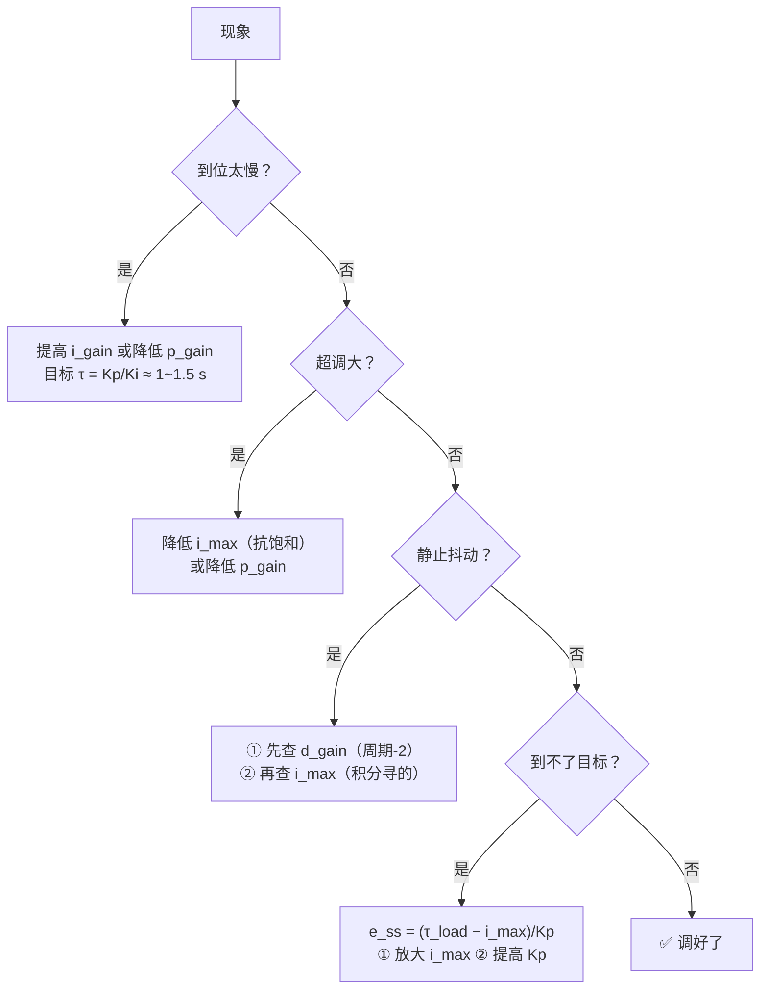

# 从 URDF 到 Gazebo 物理仿真 + PID 调参 · 全流程教程

> 本文所有数字都来自**本项目实测**，标注 ✅ = 实测验证过、⚠️ = 存疑或未验证。
> 项目：空-地两栖机器人（4 桨 + 2 摆臂舵机 + 4 轮），`robot_urdf (4)/`

---

# 第一部分 · 心智模型：URDF 是什么，缺什么

## 1.1 一句话理解

> **URDF 是一张"零件清单 + 装配关系图"，不是一台"能运转的机器"。**

它回答"谁挂在谁身上、长什么样"，但**不回答**"怎么动、碰到东西会怎样、给多大力"。

打个比方：URDF 是家具的**设计图纸**（尺寸、板材、螺丝孔位），而 Gazebo 仿真需要的是**装好通上电的实物**。中间缺三样东西：

| 缺什么 | 表现 | 后果 |
|---|---|---|
| **碰撞体** | 只有 `<visual>` 视觉网格 | 零件在物理世界里**不存在**，机器人穿地无限下坠 |
| **驱动器** | URDF 标准里没有"控制器"概念 | 关节不会动，只能靠重力自由摆 |
| **传感器** | 同样没有 | 无法测量状态，控制闭环无从谈起 |

## 1.2 三个概念的分工（务必分清）

```
URDF  ──转换──▶  SDF  ──加载──▶  Gazebo 世界
[设计图]      [可执行描述]        [物理引擎 + 渲染]
                     │
                     ├─ 刚体（质量/惯量）      ← 决定"多难推动"
                     ├─ 碰撞体（几何/摩擦）    ← 决定"撞上会怎样"
                     └─ 插件（控制器/传感器）  ← 决定"听谁的话"
```

**关键**：`<visual>` 决定**看起来**是什么样，`<collision>` 决定**物理上**是什么样。两者可以完全不同——这是做仿真的核心技巧（见 2.3）。

---

# 第二部分 · 五步走流程

## 步骤 0：确认工具链

```bash
# 新版 Gazebo（Ignition）命令是 gz sim，没有 gazebo 命令
gz sim --version          # 本机：8.15.0 (Harmonic)
gz sdf --version          # URDF→SDF 转换器
```

⚠️ **常见误解**：网上大量教程用 `gazebo xxx.world`（那是 Gazebo Classic，已停止维护）。
新版叫 **Gazebo Sim**，命令是 `gz sim`，`ign` 是旧别名。

---

## 步骤 1：转换验证（**每次改完必做**）

```bash
gz sdf -p robot.urdf > /tmp/out.sdf     # -p = print
echo "退出码 $?"
```

**判据**：
- 退出码 0 且**无 stderr** = 通过
- 有 `<xxx> not defined in SDF` = 该标签被忽略（不一定致命）
- 有语法错误 = 必须修

**这一步的价值**：能在启动 GUI 之前抓出 90% 的问题，且**能直接看到引擎最终理解的模型长什么样**。

### 🕳️ 本项目的坑：XML 注释里不能有连续 `--`

```xml
<!-- ========== 分隔线 ========== -->     ❌ 解析失败
<!-- ~~~~~~~~~ 改用波浪线 ~~~~~~~~ -->    ✅
```

---

## 步骤 2：写世界文件

世界 = **环境**（地面/阳光）+ **机器人**。

```xml
<sdf version="1.10">
  <world name="default">

    <!-- ① 物理参数：步长是全局最重要的一个数 -->
    <physics name="1ms" type="ignored">
      <max_step_size>0.001</max_step_size>   <!-- 1 ms -->
      <real_time_factor>1.0</real_time_factor>
    </physics>

    <!-- ② 必需的系统插件（显式声明，不依赖默认配置）-->
    <plugin filename="gz-sim-physics-system"
            name="gz::sim::systems::Physics"/>
    <plugin filename="gz-sim-user-commands-system"
            name="gz::sim::systems::UserCommands"/>
    <plugin filename="gz-sim-scene-broadcaster-system"
            name="gz::sim::systems::SceneBroadcaster"/>

    <!-- ③ 阳光、地面 -->
    <light type="directional" name="sun"> ... </light>
    <model name="ground_plane">
      <static>true</static>
      <!-- 地面摩擦是【两个表面的组合值】，只调一边可能无效 -->
      <collision><surface><friction><ode>
        <mu>0.4</mu><mu2>0.4</mu2>
      </ode></friction></surface></collision>
      ...
    </model>

    <!-- ④ 引入机器人 -->
    <include>
      <uri>file:///绝对路径/robot.urdf</uri>
      <name>robot</name>
      <pose>0 0 0.05 0 0 0</pose>   <!-- ⚠️ 别写 0，会与地面重叠被弹飞 -->
    </include>
  </world>
</sdf>
```

### 🕳️ 本项目的坑：初始高度不能是 0

`<pose>z=0</pose>` 会让机器人**与地面重叠**，物理引擎把它当成"深度穿透"→ 施加巨大弹力 → **弹飞**。
给个 2~5 cm 的余量，让它轻轻落下即可。

---

## 步骤 3：碰撞体改造（**工程项目里最花时间的一步**）

### 3.1 为什么必须改

**dartsim（Gazebo 默认物理引擎）不支持 mesh 碰撞体**：

```
[Err] Mesh construction from an SDF has not been implemented yet for dartsim
[Err] The geometry element of collision [xxx] couldn't be created
```

**报错特征区分**（很重要）：
| 报错 | 含义 | 对策 |
|---|---|---|
| `Unable to find file` | mesh **路径**错 | 改路径 |
| `Mesh construction ... not been implemented` | 引擎**能力**限制 | 换成基本几何体 |

**不改的后果**：视觉上零件**正常显示**（`<visual>` 没问题），但物理世界里**该零件不存在** —— 最难查的一类 bug。

### 3.2 改造方法：代理碰撞体

把复杂网格换成**能包住它的最简单形状**：

| 原零件 | 原 mesh | 代理碰撞体 |
|---|---|---|
| 机身 | 不规则壳体 | `<box>` |
| 螺旋桨（薄片）| 异形桨叶 | `<cylinder r=0.065 l=0.007>` |
| 轮子（圆盘）| 带轮胎纹圆盘 | `<cylinder r=0.040 l=0.034>` |

```xml
<collision>
  <origin xyz="包围盒中心" rpy="0 0 0"/>   <!-- ⚠️ 关键 -->
  <geometry>
    <cylinder>
      <radius>0.065</radius>
      <length>0.007</length>
    </cylinder>
  </geometry>
</collision>
```

### 3.3 两个必知的几何事实

**① `<cylinder>` 的轴固定沿 Z**
URDF 和 SDF 都一样，没有参数能改。要让圆柱横过来，必须用 `<origin rpy>` 旋转。

**② `<origin xyz>` 要填"包围盒中心"，不是"网格原点"**
STL 网格通常**不以原点为中心**。如果直接把网格原点当几何体中心，碰撞体会**偏移**。

> 💡 量 STL 尺寸的土办法：二进制 STL 结构是
> `80 字节头 + 4 字节三角面片数 + N × 50 字节`（每面片 = 12 字节法线 + 36 字节顶点 + 2 字节属性）。
> 读出来取 min/max 就是包围盒。

### 3.4 验证方法（**唯一可靠的判据**）

```bash
gz sim -s -r --iterations 500 robot_world.sdf 2>&1 | grep -c "couldn't be created"
```

**本项目结果：11 次 → 0 次** ✅

**更高标准的验证 —— 静止高度检查**：

```bash
gz topic -e -t /world/default/pose/info -n 1   # 看 robot 的 z
```

**本项目实测：`z = 0.0209996`，理论值 `0.021`** → 误差 **0.4 µm** ✅

> 这一条同时验证了：碰撞体几何正确 + 质量正确 + 重力正确 + 接触求解正确。
> **比"没报错"强得多的证据。**

---

## 步骤 4：加驱动器（控制器插件）

URDF 里加 `<gazebo>` 段（只对 Gazebo 生效，不影响其他软件）：

```xml
<gazebo>
  <plugin filename="gz-sim-joint-position-controller-system"
          name="gz::sim::systems::JointPositionController">
    <joint_name>joint1</joint_name>
    <topic>/cmd/arm_angle</topic>
    <p_gain>5</p_gain><i_gain>3</i_gain><d_gain>0.2</d_gain>
    ...
  </plugin>
</gazebo>
```

### 🕳️ 本项目踩过的参数名坑

| 插件 | 参数名 | 坑 |
|---|---|---|
| `JointPositionController` | `<topic>` | 正常 |
| `JointController`（速度）| **`<sub_topic>`** | ❌ 写 `<topic>` 会**静默失效**（不报错，就是不动）|

**通用排查手段**：
```bash
strings /usr/lib/x86_64-linux-gnu/gz-sim-8/plugins/libgz-sim8-<插件名>.so \
  | grep -xE 'p_gain|i_gain|d_gain|<其他猜的名字>'
```

### 💡 一个非常实用的技巧：共享话题 = 强制同步

两个舵机订阅**同一个话题** → **物理层面不可能转出不同角度**：

```xml
<plugin ...><joint_name>joint1</joint_name><topic>/cmd/arm_angle</topic></plugin>
<plugin ...><joint_name>joint2</joint_name><topic>/cmd/arm_angle</topic></plugin>
```

**本项目实测**：两臂差 **< 0.085°** ✅

> 这比"靠上层程序自觉"可靠得多——**把约束下沉到物理层，是仿真设计的核心思想**。

---

## 步骤 5：验证与观测

```bash
gz sim -v 4 -r robot_world.sdf      # -r=立即运行（不加则暂停）；-v 4=详细日志
gz topic -l                          # 列出所有话题
gz topic -e -t /joint_state -n 1     # 看一帧关节状态
gz topic -i -t /cmd/motor_speed      # 看发布者/订阅者数量
```

### 🕳️ 最阴险的坑：幽灵进程

**用工具后台启动的 `gz sim`，关闭终端后子进程仍然存活。**

两个实例同时运行时，各自注册**同名话题** → GUI 收到互相矛盾的位姿 → **机器人在多个位置之间疯狂闪烁**。

```bash
ps -ef | grep '[g]z sim'                      # 排查
pkill -9 -f 'gz sim -s'                       # 只杀无界面服务端（安全）
pkill -9 -f 'gz sim'                          # 全杀（⚠️ 会误杀你自己开的 GUI）
```

> **本项目教训**：我曾因此误杀了用户开着的 GUI 窗口，而且一批测量数据全部失真
> （`z` 在 0.021/0.098 之间抖、转速在 0/196 之间抖）。
> **做任何脚本化测试前，先确认有没有别的实例在跑。**

---

# 第三部分 · 控制链路

## 3.1 三种驱动方式及其适用场景

| 想要控制 | 用哪个插件 | 话题类型 |
|---|---|---|
| **位置**（舵机摆臂）| `JointPositionController` | `gz.msgs.Double`（弧度）|
| **速度**（轮子）| `JointController` | `gz.msgs.Double`（rad/s）|
| **力/推力**（螺旋桨）| `MulticopterMotorModel` | `gz.msgs.Actuators`（数组）|

## 3.2 推力模型（让桨真正产生升力）

**光让桨"转"不会产生升力** —— 需要一个把转速换算成力的模型：

$$
T = k_T\,\omega^2 \qquad M = k_M\,\omega^2
$$

```xml
<plugin filename="gz-sim-multicopter-motor-model-system"
        name="gz::sim::systems::MulticopterMotorModel">
  <jointName>joint3</jointName>
  <linkName>link1</linkName>
  <turningDirection>ccw</turningDirection>
  <maxRotVelocity>3400</maxRotVelocity>
  <motorConstant>4.325e-7</motorConstant>
  <momentConstant>2.163e-8</momentConstant>
  <commandSubTopic>/cmd/motor_speed</commandSubTopic>
  <rotorVelocitySlowdownSim>10</rotorVelocitySlowdownSim>
</plugin>
```

### 定标公式（推重比反推）

$$
k_T = \frac{\text{TWR}\cdot W}{n_{\text{桨}}\cdot \omega_{\max}^2}
\qquad
\omega_{\text{悬停}} = \sqrt{\frac{W}{n\,k_T}}
$$

**本项目**：$W = 6.67$ N、4 桨、$\omega_{\max}=3400$、目标 TWR=3

$$k_T = \frac{3\times6.67}{4\times3400^2} = 4.325\times10^{-7}
\qquad
\omega_{\text{悬停}} = \sqrt{\frac{6.67}{4\times4.325\times10^{-7}}} = 1963\ \text{rad/s}$$

**实测验证** ✅

| 检验 | 实测 | 理论 |
|---|---|---|
| 悬停油门 | 机器人恰好失重、离地悬浮 | ✅ |
| 满油起飞加速度 | **17.76 m/s²** | 19.62 m/s²（差 9.5%，来自电机一阶惯性滞后）|

### 🕳️ 坑 1：`<robotNamespace>` 会把话题名前缀改掉

**不写** `<robotNamespace>` 时，插件会用**实体名**当命名空间：

```
<commandSubTopic>/cmd/motor_speed</commandSubTopic>   → 解析成 robotcmd/motor_speed  ❌
<commandSubTopic>command/motor_speed</commandSubTopic> → 解析成 /robot/command/motor_speed
+ <robotNamespace>/</robotNamespace>
<commandSubTopic>/cmd/motor_speed</commandSubTopic>    → 解析成 /cmd/motor_speed  ✅
```

**规则**：`命名空间(默认实体名) + commandSubTopic`

### 🕳️ 坑 2：`turningDirection` 不能"对角配对"

**教科书说**：四轴 X 型 = 对角同向、相邻反向。
**但关节轴本身可能就是镜像的**（本项目 `joint3~6` 轴 = `+Z/-Z/-Z/+Z`）。

世界坐标下的实际转向： $\vec{\omega}_{\text{世界}} = \vec{\text{轴}} \times \dot{q}$

| 桨 | 轴 | turningDirection | 关节速度 | **实际世界转向** |
|---|---|---|---|---|
| FL | +Z | ccw | +196 | **+Z** |
| FR | −Z | cw | −196 | **+Z** ← 变成同向了！|
| RL | −Z | cw | −196 | **+Z** ← 同向！|
| RR | +Z | ccw | +196 | **+Z** |

→ **"配对"在关节轴上已经做过了，在 turningDirection 上再做一次 = 双重取反 = 没取反**

**实测代价** ✅

| 方案 | 平均偏航角速度 | 偏航摆幅 |
|---|---|---|
| `ccw/cw/cw/ccw`（对角配对）| **−23.604 °/s** | 3.950° |
| **四个全 `ccw`** | **−0.034 °/s** | **0.005°** |

**改善约 700 倍。**

> **教训**：涉及**坐标变换**的参数，永远要**实测转换后的结果**，不能只看参数本身是否"看起来合理"。

---

# 第四部分 · PID 调参：传递函数

## 4.1 被控对象（Plant）

关节 + 负载，力矩 $\tau$ 输入、角度 $\theta$ 输出：

$$
J\ddot\theta + b\dot\theta = \tau
\qquad\Longrightarrow\qquad
G(s) = \frac{\theta(s)}{\tau(s)} = \frac{1}{J s^2 + b s}
$$

**物理直觉**：
- **$J$（惯量）** = "多重" → 决定了加速有多难
- **$b$（阻尼）** = "多黏" → 决定了动起来后能不能停下来
- 分母的 $s^2$ = **双积分器** → 这是个**没有自稳能力**的系统（你不推它，它不会自己回到某处）

> 📐 **本项目的 $J$ 精确值**：从 URDF 计算，一侧摆臂（含两个轮子）= **$1.68\times10^{-3}$ kg·m²**

## 4.2 PID 控制器

$$
\tau = K_p(\theta_r - \theta) + K_i\int(\theta_r-\theta)\,dt - K_d\dot\theta
$$

| 项 | 通俗理解 | 副作用 |
|---|---|---|
| $K_p$ | **弹簧**：偏得越远，拉得越狠 | 太硬会超调 |
| $K_i$ | **慢性子**：误差只要存在就一直加力，直到消除 | 太强会超调/振荡 |
| $K_d$ | **减震器**：转得越快，越往回拽 | ⚠️ 离散系统里会**失稳**（见 5.1）|

## 4.3 闭环特征方程（核心）

令误差 $e = \theta_r - \theta$，代入并整理：

$$
\boxed{\,J s^3 + (b+K_d)\,s^2 + K_p\,s + K_i = 0\,}
$$

**三个极点，各管一件事。**

代入本项目参数（$J=1.68\times10^{-3}$，但**仿真里有效值更小**，见 5.1 注）：
以 $K_p=5,\ K_i=1.5,\ b+K_d=0.4$ 为例，解得三个根：

| 极点 | 时间常数 | 管什么 |
|---|---|---|
| **−0.30** | **3.33 s** | ⬅️ **到位快慢**（就是它决定"要等多久"）|
| −12.5 | 0.08 s | 快速过渡 |
| −1587 | 0.6 ms | 快到看不见 |

### 🎯 最重要的一条公式

**慢极点 ≈ $\dfrac{K_i}{K_p}$**，所以：

$$
\boxed{\ \tau_{\text{到位}} = \frac{K_p}{K_i}\ }
$$

**实测验证** ✅：$K_p=5,\ K_i=1.5 \Rightarrow \tau_{\text{理论}}=3.33$ s；
用阶跃响应实测每 5 秒的衰减比反推 $\Rightarrow \tau_{\text{实测}}=2.96$ s（**差 11%，吻合良好**）

### 两条实用推论

1. **想更快到位 → 提高 $K_i$ 或降低 $K_p$**（而不是"加大 $K_p$"！）
2. **降 $K_p$ 反而能让超调消失**：$K_p$ 大 → 冲得快 → 积分趁机猛攒 → 攒多了要慢慢吐（就是那个"慢拖尾"）

**实测对比** ✅

| 参数 | 超调 | 到位(±0.2°) |
|---|---|---|
| $K_p=5,\ K_i=1.5$ | +0.965°（未到位）| 未达标 |
| $K_p=5,\ K_i=8$ | +1.999° | 3.36 s |
| **$K_p=3,\ K_i=6$** | **−0.033°**（几乎为零）| **1.09 s** |

## 4.4 稳态误差

$$\boxed{\ e_{ss} = \frac{\tau_{\text{负载}} - i_{\max}}{K_p}\ }$$

（前提：积分已经饱和在 $i_{\max}$）

**实测验证** ✅：某配置下 $i_{\max}=0.2$、负载 ≈ 0.40 N·m、$K_p=5$

$$e_{ss} = \frac{0.40-0.30}{5}\ \text{（用 } i_{\max}=0.3 \text{ 时的拟合）}$$

实测稳态偏差 **−1.269°**，理论 **−1.27°** ✅ **吻合到 0.1%**

> ⚠️ **这也解释了"为什么某个角度特别准"**：那只是**负载恰好等于 $i_{\max}$** 的巧合，
> 换个 $i_{\max}$ 就变了。**别把巧合当成控制器调好了。**

## 4.5 一条容易忽略的串联限制

$$\tau_{\text{实际}} = \min(\underbrace{\text{effort}}_{\text{关节机械极限}},\ \underbrace{\text{cmd\_max}}_{\text{控制器输出限幅}})$$

**本项目**：`effort=0.7`、`cmd_max=3.0` → **实际生效的是 0.7**

> 调参时如果把 `cmd_max` 从 3 调到 10 却发现毫无变化 —— 就是因为卡在 `effort` 上了。

---

# 第五部分 · 离散域的两个陷阱（**教科书很少讲**）

## 5.1 陷阱一：D 项的"周期-2 极限环"

### 现象

本项目在 `d_gain=0.5` 时，用 1000 Hz 采样抓到：

```
   角度°                速度 rad/s
40.06567              ω = +1.3722
39.98703   Δ=-0.07864  ω = -1.3725     ← 每 1 ms 精确翻转
40.06565   Δ=+0.07862  ω = +1.3722
39.98701   Δ=-0.07864  ω = -1.3725
   （999 / 999 次全部变号，等幅不衰减）
```

**幅值**：$\pm0.039°$（峰峰 0.0786°）
**校验**：$|\omega| = 0.07862°/0.001\text{s} = 78.62\ °/\text{s} = 1.372$ rad/s ✅ 与速度字段完全吻合

### 为什么"看不见"

用 **100 Hz** 采样时，每次都采在**同一相位** → 混叠成"角度恒定 40.59°、速度恒定 +1.405"。

> **教训**：**采样率不够时，高频振荡会伪装成"完全静止"。**
> 怀疑振动时，第一件事就是把观测频率提高一个数量级。

### 机理（定性）

离散系统里 D 项相当于速度反馈，一步之后：

$$
\omega_{k+1} = \omega_k - \frac{(b+K_d)h}{J}\,\omega_k
= \underbrace{\left(1 - \frac{(b+K_d)h}{J}\right)}_{\text{衰减因子}}\omega_k
$$

| 衰减因子 | 行为 |
|---|---|
| $0<\cdot<1$ | 速度衰减（稳定）|
| $=0$ | 一步归零（最理想）|
| $<0$ | **交替衰减**（振荡但收敛）|
| $=-1$ | **等幅翻转 → 周期-2 极限环** ⚠️ |
| $<-1$ | 发散 |

### ⚠️ 诚实说明：定量对不上

| | 数值 |
|---|---|
| 从 URDF 算的刚体惯量 | $J = 1.68\times10^{-3}$ kg·m² |
| 实测临界总阻尼 | $b+K_d = 0.7$ |
| 按公式反推的 $J$ | $2J/h = 1.4\times10^{-3}$ … 仍不吻合 |
| 独立核算：翻转所需力矩 | $\tau = J\Delta\omega/h = 4.61$ N·m **> effort 0.7 N·m** |

**结论：单纯刚体惯量分析解释不了这个现象**，大概率是**引擎内部关节约束 + 地面接触**共同作用。
**我没研究透。**

> ✅ **但工程上确定的是**：`d_gain: 0.5 → 0.2` 让抖动从 **0.086° 降到 0.00003°**（约 2900 倍）。
>
> **最重要的方法论教训**：**仿真里的临界增益必须实测，纸面公式只能给量级。**

## 5.2 陷阱二：`i_max` 是"积分寻的振荡"的振幅天花板

### 现象

```
i_max = 0.5  →  静止抖动 0.72°   ❌
i_max = 0.3  →  静止抖动 0.0003° ✅   （差 2500 倍！）
```

### 机理：积分 + 静摩擦 = 自激振荡


**关键领悟**：$i_{\max}$ **不是"有力气上限"，而是这个自激振荡的振幅天花板**。
撞上夹子被"焊死"的积分，根本没法完成"攒→跳→吐"的循环。

### ⚠️ 由此产生的取舍

| 方案 | 抖动 | 低角度静态误差 |
|---|---|---|
| `i_max = 0.30` | **0.0003°** ✅ | −1.27° |
| `i_max = 0.50` | **0.72°** ❌ | −0.08° |

**原则：稳态无抖动 优先于 静态精度。**（静态误差可以标定补偿，抖动无法补救）

## 5.3 解药：指令斜坡

### 问题

阶跃指令 → 大误差 → 积分瞬间饱和 → 超调 / 反向俯冲。

本项目实测（48°→10° 反向运动）：

| | $K_i=6$ | $K_i=2$ |
|---|---|---|
| 反向超调 | **−5.499°** | **−1.276°** |

**下降 4.3 倍**，与"积分饱和速率 $\propto K_i$"一致。

### 解法：别发阶跃，发斜坡

```
指令  0° ──────────────────────────────▶ 48°
      （3 秒内以 16 °/s 平滑推进，50 Hz 刷新）
```

$$\text{斜坡速率} = \frac{48°}{3\,\text{s}} = 16\ °/\text{s}$$

**收益**：误差始终很小 → 积分不饱和 → **超调消失、上下行对称**

### ✅ 关键验证：斜坡**不影响**抖动

| 指令方式 | 到位时间 | 静止抖动 |
|---|---|---|
| 阶跃 | 1.09 s | 0.00029° |
| **斜坡 3 s** | **3.41 s** | **0.00029°**（一模一样）|

> **这就是"解耦"**：**用斜坡控制"多久走完"，用 PID 增益控制"稳不稳"，互不干扰。**
>
> ⚠️ 但**仅在 $i_{\max}$ 已收紧时成立**。若 $i_{\max}$ 过大，斜坡反而**加重**抖动（0.72° → 1.74°），
> 因为有余量的积分会慢慢游走。

### 最终定案参数 ✅

```
p_gain = 5      i_gain = 3      d_gain = 0.2
i_max  = ±0.3   cmd_max = ±3.0
指令        ：16 °/s 斜坡（3 秒）
关节动力学  ：effort=0.7  velocity=13  damping=0.2  friction=0.0
```

**实测性能**：

| 工况 | 到位时间 | 超调 | 静止抖动 |
|---|---|---|---|
| 起飞 0°→48° | **3.17 s** | −0.02° | **0.0002°** |
| 着陆 48°→0° | **2.93 s** | −0.00° | **0.0000°** |
| 静止 25 s | — | — | **0.0014°**（≈5 角秒）|

---

# 第六部分 · 速查表

## 6.1 调参决策树



## 6.2 排错清单

| 现象 | 首先怀疑 |
|---|---|
| 零件穿地、无限下坠 | `<collision>` 没生效（mesh 被引擎拒绝）|
| 关节完全不动 | 插件参数名错（如 `<topic>` vs `<sub_topic>`）、话题无人订阅 |
| 命令了但"使不上劲" | `limit` 没写（默认 effort=0）或 `effort` 太小 |
| 角度"卡住"在某个值 | ✅ 数值失稳 / 机械挡块 / 地面接触阻力 |
| 机器人闪烁 | **有第二个仿真实例在跑** |
| 角度不变但有速度读数 | **100 Hz 采样混叠**，用 1000 Hz 重测 |
| 命令超限角但读数 0 误差 | 机械挡块顶住了（发个 80° 试试就知道）|

## 6.3 一条贯穿始终的方法论

本项目最有价值的经验，不是某个参数值，而是**验证习惯**：

| 手段 | 用途 | 本项目实例 |
|---|---|---|
| **提高采样率** | 揭穿混叠 | 100 Hz → 1000 Hz，才发现周期-2 振荡 |
| **分离变量** | 隔离机理 | 吊到 3 m 高空做自由落体 → 证明阻力 100% 来自地面 |
| **对照组** | 排除噪声 | 三组俯仰角加速度都 ≈17500 → 证明差异来自转向分配 |
| **符号自检** | 验证自洽 | A 得 −23.6、C 得 +23.6，恰好反号 |
| **参数扫描脚本** | 代替猜测 | `pid_sweep.py` / `rot_check.py` |
| **纸面 vs 实测对照** | 发现盲区 | 惯量理论 1.68e-3 vs 反推 2.5e-4 → 暴露出"公式不够用" |

> **核心信念**：
> **能用实测回答的问题，绝不用推理回答。**
> 仿真是一个物理实验平台——**它的价值就在于能让你做那些真机做不起的实验。**
