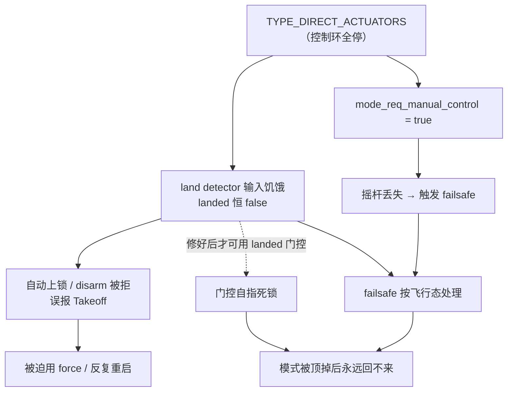

# PX4 地面驱动方案（空-地双模）

> 副标题：用「外部模式 + DirectActuators」实现飞行/地面双模，零改动现有模块
> 时间：2026-10-14（调研 + 设计）→ 2026-10-17（P0~P4 全部实测通过）
> 状态：**P0 + P1 + P2 + P3 + P4 均已实测通过**，并可连续驾驶（含双向倒车、非 force 解锁）
> 前置文档：`PX4移植实录.md`（主体移植）、`摆臂舵机接入PX4实录.md`（舵机全链路）
> **操作命令**（启动 / 关闭 / 清理 / GUI / 验证 / 故障速查）：见 [`命令手册.md`](命令手册.md)
> PX4 版本：v1.18.0-beta1 @ `/home/yuan/PX4-Autopilot`
>
> ⚠️ **先读这两章再看代码**：第 12 章（双向编码 / DShot 3D 对齐）与
> 第 13 章（地面模式的三个系统性陷阱）。P4 阶段踩的坑全部在那里，
> 每一条都表现为「代码看起来没问题，行为却完全不对」。

---

## 目录

- [第 0 章 · 目标与硬约束](#第-0-章--目标与硬约束)
- [第 1 章 · 调研结论：5 个架构基石](#第-1-章--调研结论5-个架构基石)
- [第 2 章 · 被否掉的方案](#第-2-章--被否掉的方案)
- [第 3 章 · 最终架构](#第-3-章--最终架构)
- [第 4 章 · ground_drive 模块设计](#第-4-章--ground_drive-模块设计)
- [第 5 章 · 切换流程时序](#第-5-章--切换流程时序)
- [第 6 章 · 摆臂角度外推器](#第-6-章--摆臂角度外推器)
- [第 7 章 · 差速运动学与单位换算](#第-7-章--差速运动学与单位换算)
- [第 8 章 · 分阶段实施计划](#第-8-章--分阶段实施计划)
- [第 9 章 · 待确认清单（🔴 动手前必须查清）](#第-9-章--待确认清单-动手前必须查清)
- [第 10 章 · 风险与缓解](#第-10-章--风险与缓解)
- [第 11 章 · 全流程总览（源码级）](#第-11-章--全流程总览源码级)
- [第 12 章 · 双向编码：从「未解锁倒车」到 DShot 3D 对齐](#第-12-章--双向编码从未解锁倒车到-dshot-3d-对齐)
- [第 13 章 · 地面模式的三个系统性陷阱](#第-13-章--地面模式的三个系统性陷阱)
- [第 14 章 · P5 转向标定：一次「软件无解」的完整排查](#第-14-章--p5-转向标定一次软件无解的完整排查)
- [附录 A · PX4 源码索引](#附录-a--px4-源码索引)
- [附录 B · 官方范例（照抄对象）](#附录-b--官方范例照抄对象)

---

## 第 0 章 · 目标与硬约束

### 目标

让机器人**既能飞、又能跑**，共用同一套 4 个电机。

### 机械事实（用户确认）

| 项 | 事实 |
|---|---|
| 桨和轮 | **XY 完全同轴**（`joint3`桨 vs `joint7`轮：Δxy = 0.0000，z 差 51.8 mm） |
| 电机 | **同一个电机** |
| 减速 | 地面侧加 **64:1 行星减速器** |
| 切换机制 | **机械上设计好了**（地面→轮 / 空中→桨） |

```
robot.urdf 关节树：
base
 ├─ link9  ← joint1 (轴 +X)  ← 左摆臂
 │    ├─ link1 / link3   螺旋桨 ✈️   (joint3 / joint5, axis 0 0 ±1)
 │    └─ link5 / link7   轮子  ⚙️   (joint7 / joint9, axis 0 0 -1)
 └─ link10 ← joint2 (轴 −X)  ← 右摆臂
      ├─ link2 / link4   螺旋桨 ✈️   (joint4 / joint6, axis 0 0 ±1)
      └─ link6 / link8   轮子  ⚙️   (joint8 / joint10, axis 0 0 +1)
```

### 三条设计约束（用户选定）

| 约束 | 选择 | 影响 |
|---|---|---|
| 摆臂角度判据 | **定时器外推**（不读实际角度） | 简单；但舵机卡住时会误判 |
| 「同一个电机」 | **机械上设计好了** | ⭐ 大简化：PX4 只需**一路输出**（4 个电机通道），不用管切换 |
| 地面自动驾驶 | **先不用** | 只走手动（摇杆），不接 navigator 的 waypoint |

### 现有基线（已实现，不能破坏）

```
SIM_GZ_EC_FUNC1..4 = 101..104   电机 → /model/airground_0/command/motor_speed (Actuators)
                                 → AirGroundMux（自写插件，2026-10-17）
                                     ├ 桨 joint3~6：4×MulticopterMotorModel
                                     └ 轮 joint7~10：4×JointController（64:1 减速）
SIM_GZ_EC_DIS1..4  = 500        未解锁 == DShot 3D 中位 == 停（§12.1）
SIM_GZ_SV_FUNC1    = 301         摆臂舵机 → /model/airground_0/servo_0
SIM_GZ_WH_FUNC*    = 0           轮子专用通道（**未启用**；`GZMixingInterfaceWheel` 与
                                 ESC 接口抢同一话题，且硬编码 offset=100，故不用）
CA_AIRFRAME        = 0           Multirotor
CA_R_REV           = 15          四路可逆（实车启用 DShot 3D，仿真由 mux 模拟）
```

---

## 第 1 章 · 调研结论：5 个架构基石

### 基石 1 · `control_allocator` 有一个现成的「让位开关」

```cpp
// src/modules/control_allocator/ControlAllocator.cpp:367
_publish_controls = vehicle_control_mode.flag_control_allocation_enabled;

// src/modules/control_allocator/ControlAllocator.cpp:717
void ControlAllocator::publish_actuator_controls()
{
    if (!_publish_controls) {
        return;                      // ★ 让位：不再发布 actuator_motors
    }
    ...
    _actuator_motors_pub.publish(actuator_motors);   // :757
}
```

**⇒ 只要能关掉 `flag_control_allocation_enabled`，`control_allocator` 就自动停发。**
**⇒ 这是「零改动飞行链」的关键。**

### 基石 2 · `SetpointType::DirectActuators` 就是那个开关

```cpp
// src/modules/commander/ModeUtil/setpoint_types.cpp:51
case SetpointType::DirectActuators:
    // Nothing enabled                          ← ★ 所有 flag 关闭
    break;
```

```cpp
// src/modules/commander/ModeUtil/setpoint_types.cpp:173  isSetpointTypeValid()
case SetpointType::DirectActuators:
    return SetpointTypeResult::Success;         // ★ 全机型通用，不看 vehicle_type

// 对比 rover 专用类型：
case SetpointType::RoverThrottleSteering:
case SetpointType::RoverPosition:
...
    if (vehicle_type == vehicle_status_s::VEHICLE_TYPE_ROVER) {
        return SetpointTypeResult::Success;
    }
    return SetpointTypeResult::Unsupported;     // ★ 我们是 ROTARY_WING，全部过不了
```

**⇒ `DirectActuators` 是唯一「全机型通用 + 能关掉 allocation」的类型。**
**⇒ 而且 rover 专用类型因为 `vehicle_type != ROVER` 全部不可用 → `rover_differential` 整条链都接不上。**

### 基石 3 · 有 8 个「外部模式」槽位，可通过 MAVLink 进入

```cpp
// msg/versioned/VehicleStatus.msg:55-62
uint8 NAVIGATION_STATE_EXTERNAL1 = 23
uint8 NAVIGATION_STATE_EXTERNAL2 = 24
...
uint8 NAVIGATION_STATE_EXTERNAL8 = 30
```

```cpp
// src/modules/commander/Commander.cpp:989 —— MAVLink 进入
case PX4_CUSTOM_SUB_MODE_EXTERNAL1...PX4_CUSTOM_SUB_MODE_EXTERNAL8:
    desired_nav_state = vehicle_status_s::NAVIGATION_STATE_EXTERNAL1
                      + (custom_sub_mode - PX4_CUSTOM_SUB_MODE_EXTERNAL1);
```

```cpp
// src/modules/commander/ModeUtil/control_mode.cpp:155 —— 外部模式用外部指定的 setpoint type
case vehicle_status_s::NAVIGATION_STATE_EXTERNAL1 ... NAVIGATION_STATE_EXTERNAL8:
    getControlMode(external_mode_setpoint_type, vehicle_control_mode);
    break;
```

### 基石 4 · 注册机制全自动（不用改 commander）

```cpp
// src/modules/mc_raptor/mc_raptor.cpp:254 —— 官方范例
register_ext_component_request_s req{};
req.timestamp = hrt_absolute_time();
strncpy(req.name, "RAPTOR", sizeof(req.name) - 1);
req.request_id = Raptor::EXT_COMPONENT_REQUEST_ID;
req.px4_ros2_api_version = register_ext_component_request_s::LATEST_PX4_ROS2_API_VERSION;
req.register_arming_check = true;
req.register_mode        = true;
_register_ext_component_request_pub.publish(req);
```

```
→ ModeManagement::checkNewRegistrations()     (ModeManagement.cpp:307)
→ Modes::addExternalMode(mode)                (ModeManagement.cpp:106)
→ 分配 nav_state = NAVIGATION_STATE_EXTERNAL1 + N
→ 回 register_ext_component_reply{mode_id, arming_check_id}
```

**⇒ 模块自己注册；`commander` / `ModeManagement` 零改动。**

### 基石 5 · ⚠️ 两个必须绕开的坑

#### 坑 1：`actuator_motors` 是**单实例** `Publication`

```cpp
// src/modules/control_allocator/ControlAllocator.hpp:210
uORB::Publication<actuator_motors_s> _actuator_motors_pub{ORB_ID(actuator_motors)};

// src/modules/rover_differential/DifferentialActControl/DifferentialActControl.hpp:96
uORB::Publication<actuator_motors_s> _actuator_motors_pub{ORB_ID(actuator_motors)};

// src/lib/mixer_module/functions/FunctionMotors.hpp:52  —— 订阅 instance 0
_topic(&context.work_item, ORB_ID(actuator_motors)),
```

**⇒ 两个发布者写同一 topic = 未定义行为（谁后写谁赢，无法区分）。**
**⇒ 必须保证同一时刻只有一个在发。**

#### 坑 2：`FunctionMotors::update()` 收不到新样本时 **`_data` 冻结**

```cpp
// src/lib/mixer_module/functions/FunctionMotors.hpp:62
void update() override
{
    if (_topic.update(&_data)) {
        updateValues(_data.reversible_flags, _thrust_factor, _data.control, ...);
    }
    // ⚠️ 没有 else → 收不到新样本时 _data 保持不变
}
```

**⇒ 停止发布 → 电机保持最后转速（不会自动归零）！**

**⇒ 解法：切换必须在【未解锁】状态。** 那时 `mixer_module.cpp:461` 让输出落到 disarmed 值：

```cpp
// src/lib/mixer_module/mixer_module.cpp:461
if (_armed.armed || (_armed.prearmed && _functions[i]->allowPrearmControl())) {
    outputs[i] = _functions[i]->value(_function_assignment[i]);
} else {
    outputs[i] = NAN;                          // → 回落 _disarmed_value[i]
}
```

---

## 第 2 章 · 被否掉的方案

### 用户想法 1：地面模式做成 FlightTask + 直接发指令给电机

**❌ 内部自相矛盾。** FlightTask 的输出是 `trajectory_setpoint`，离电机隔着 3 层：

```
FlightTask → trajectory_setpoint
    → PositionControl      → vehicle_attitude_setpoint / thrust
    → AttitudeControl      → vehicle_rates_setpoint
    → RateControl          → vehicle_torque_setpoint + vehicle_thrust_setpoint
    → control_allocator    → actuator_motors          ← 电机在这
```

要「直接发」只有两条路：
- 在 `PositionControl`/`AttitudeControl` 里插「地面分支」→ 🔴 **污染多旋翼控制链**
- 让 FlightTask 输出被旁路模块截获 → 那它就不是 FlightTask 了

而且 FlightTask 的切换由 `flight_mode_manager` 按 `vehicle_status.nav_state` 自动选，加新模式会扩散到 6+ 个文件。

### 用户想法 2：新增 `gate_controller` 挂 navigator

**✅ 方向对（复用导航格式），但 ❌ 会重复造轮子 + 没解决核心问题。**

- PX4 已有 `rover_differential`（位置/速度/角速度/姿态/执行器 5 个环 + pure_pursuit）
- **核心问题没解决**：谁写 `actuator_motors`？两个模块同时写就打架 —— **还得再造一个仲裁器**

### 方案 D2：切 `CA_AIRFRAME` 到 Rover

- ❌ `CA_AIRFRAME` 是全局参数，且是**启动期**二选一
- ❌ 我们的轮子是「两侧各 2 个」，不是标准差速布局
- ❌ 切机型要重新初始化分配器

### 方案 A：纯 Gazebo 插件耦合

- ❌ 只对仿真有效，**不能迁到真机**（用户要上真机）

---

## 第 3 章 · 最终架构

```
┌───────────── 飞行模式（nav_state = POSCTL / MANUAL / AUTO…）─────────────┐
│  flight_mode_manager → PositionControl → AttitudeControl → RateControl   │
│      → control_allocator ──► actuator_motors ──┐                        │
│      （setpoint type = Trajectory，flag_allocation = true）              │
└────────────────────────────────────────────────┼─────────────────────────┘
                                                 │
┌───────────── 地面模式（nav_state = EXTERNAL1+N）─────────────────────────┐
│                                                                          │
│  ★ ground_drive 模块（新增，唯一的新模块）★                                │
│    · 注册外部模式 → 拿到 mode_id                                          │
│    · 激活时发 setpoint_config{TYPE_DIRECT_ACTUATORS}                      │
│         → flag_control_allocation_enabled = false                        │
│         → control_allocator 自动停发 ✅（零改动！）                        │
│    · 摆臂角度估计（定时器外推）→ 门控 ≥48°                                 │
│    · 读 manual_control_setpoint（throttle=前进 / roll=转向）               │
│    · 差速运动学 → 4 轮转速 → 归一化                                       │
│    · actuator_motors ◄── 唯一发布者 ✅                                    │
└────────────────────────────────────────────────┼─────────────────────────┘
                                                 ▼
                        GZMixingInterfaceESC → SIM_GZ_EC_FUNC1..4
                                                 ▼
                     /model/airground_0/command/motor_speed (Actuators)
                                                 ▼
                                   ┌─────────────────────────────┐
                                   │  AirGroundMux（自写 gz 插件） │
                                   │  读 servo_0 角度：≥48° ? 轮 : 桨 │
                                   │  SignedNorm：0..1000 → −1..+1  │
                                   └──────┬───────────────┬──────┘
                                          ▼               ▼
                          4×MulticopterMotorModel   4×JointController
                              （桨 joint3~6）        （轮 joint7~10, 64:1）
                              只正转 max(0,s)         双向，0=停（中位 500）
```

### 改动清单

| 文件 | 改动 |
|---|---|
| `src/modules/ground_drive/ground_drive.cpp` | **新增** |
| `src/modules/ground_drive/ground_drive.hpp` | **新增** |
| `src/modules/ground_drive/module.yaml` | **新增**（参数） |
| `src/modules/ground_drive/CMakeLists.txt` | **新增** |
| `src/modules/ground_drive/Kconfig` | **新增** |
| `boards/px4/sitl/default.px4board` | **+1 行** `CONFIG_MODULES_GROUND_DRIVE=y` |
| airframe `4030_gz_airground`（或 `rcS`） | **+1 行** `ground_drive start` |

**❌ 零改动：** `control_allocator` / `commander` / `rover_differential` / `gz_bridge` / `flight_mode_manager`

---

## 第 4 章 · `ground_drive` 模块设计

### 4.1 类结构（`ground_drive.hpp`）

```cpp
class GroundDrive : public ModuleBase, public ModuleParams, public px4::ScheduledWorkItem
{
public:
    static Descriptor desc;
    static int task_spawn(int argc, char *argv[]);
    static int custom_command(int argc, char *argv[]);
    static int print_usage(const char *reason = nullptr);
    bool init();
    void Run() override;

private:
    // ① 注册 / 注销
    void registerExternalMode();
    void unregisterExternalMode();
    void handleRegistrationReply();

    // ② arming check
    void replyToArmingCheck(uint8_t request_id);

    // ③ 模式激活
    void activateMode();        // 发 setpoint_config
    void deactivateMode();

    // ④ 摆臂角度外推器
    void updateServoEstimate();

    // ⑤ 地面控制
    void manualDrive(uint64_t now);
    void publishZeroMotors(uint64_t now);

    // 状态
    static constexpr uint64_t kRequestId = 0x67726F756E645F31ULL;  // 'ground_1'
    static constexpr char     kModeName[] = "GROUND_DRIVE";
    bool     _registered{false};
    int8_t   _arming_check_id{-1};
    int8_t   _mode_id{-1};
    bool     _mode_active{false};

    float    _servo_cmd_value{-1.f};
    uint64_t _servo_cmd_time{0};
    float    _servo_angle_est_deg{0.f};

    vehicle_status_s _vehicle_status{};   // ★ 缓存（Run() 刷新），供 arming check 读 armed

    uORB::Publication<register_ext_component_request_s> _reg_req_pub{ORB_ID(register_ext_component_request)};
    uORB::Subscription  _reg_reply_sub{ORB_ID(register_ext_component_reply)};
    uORB::Subscription  _arming_check_req_sub{ORB_ID(arming_check_request)};
    uORB::Publication<arming_check_reply_s> _arming_check_reply_pub{ORB_ID(arming_check_reply)};
    uORB::Publication<setpoint_config_s>    _setpoint_config_pub{ORB_ID(setpoint_config)};
    uORB::Publication<actuator_motors_s>    _actuator_motors_pub{ORB_ID(actuator_motors)};
    uORB::Subscription  _vehicle_status_sub{ORB_ID(vehicle_status)};
    uORB::Subscription  _vehicle_command_sub{ORB_ID(vehicle_command)};
    uORB::Subscription  _manual_control_sub{ORB_ID(manual_control_setpoint)};
    uORB::Subscription  _land_detected_sub{ORB_ID(vehicle_land_detected)};
    uORB::Subscription  _parameter_update_sub{ORB_ID(parameter_update)};

    // ⚠️ PX4 参数名上限 16 字符，超了会编译失败：
    //    "Parameter Name XXX is too long (Limit is 16)"
    //    所以下面三个名字比初版短（见变更记录 2026-10-17）
    DEFINE_PARAMETERS(
        (ParamFloat<px4::params::GD_SERVO_RATE>)  _param_servo_rate,   // deg/s（原 GD_SERVO_RATE_DPS）
        (ParamFloat<px4::params::GD_ARM_MIN_DEG>) _param_arm_thresh,   // deg  （原 GD_ARM_THRESH_DEG）
        (ParamFloat<px4::params::GD_MAX_SPEED>)   _param_max_speed,
        (ParamFloat<px4::params::GD_WHEEL_TRACK>) _param_wheel_track,
        (ParamFloat<px4::params::GD_YAW_GAIN>)    _param_yaw_gain,
        (ParamFloat<px4::params::GD_MAX_OMEGA>)   _param_motor_max,    // rad/s（原 GD_MOTOR_MAX_OMEGA）
        (ParamFloat<px4::params::GD_GEAR_RATIO>)  _param_gear_ratio,   // 64:1 行星减速器（P3 新增）
        (ParamFloat<px4::params::GD_WHEEL_R>)     _param_wheel_r,      // 轮半径 0.04 m（P3 新增）
        (ParamInt<px4::params::CA_R_REV>)         _param_r_rev         // ★ 与官方 rover 一致
    );
};
```

### 4.2 主循环

> ⚠️ 下面是 **设计稿**，与落地代码 `px4_changes/ground_drive/ground_drive.cpp` 有两处差异：
> ① 多了 ⓪ 步（刷新 `landed`，必须在 arming check 之前）；② ⑥ 步多了 `publishThrustZero()`
> （land detector 输入补偿，见 §4.7）。**顺序不能改**：`landed` 与 `thrust setpoint`
> 都是 arming check / commander 的输入，晚一拍就会产生帧级抖动（详见第 13 章）。

```cpp
void GroundDrive::Run()
{
    if (should_exit()) { unregisterExternalMode(); exit_and_cleanup(desc); return; }

    if (_parameter_update_sub.updated()) { updateParams(); }

    // ⓪ 刷新落地状态 —— 必须在 ② arming check 之前（commander 随时可能来问）
    vehicle_land_detected_s land{};
    if (_vehicle_land_detected_sub.update(&land)) { _landed = land.landed; }

    // ① 注册（未成功则 1 s 重试）
    if (!_registered) { tryRegister(); handleRegistrationReply(); }

    // ② 响应 arming check（commander 定期问）
    arming_check_request_s req;
    for (int i = 0; i < kMaxMsgPerCycle; i++) {
        if (!_arming_check_req_sub.update(&req)) { break; }
        replyToArmingCheck(req.request_id);
    }

    // ③ 摆臂角度外推（每周期）
    updateServoEstimate();

    // ④ 检测模式激活 / 退出
    vehicle_status_s vs;
    if (_vehicle_status_sub.update(&vs)) {
        _vehicle_status = vs;                      // ★ 刷新缓存（arming check 读 armed 用）
        const bool active = _registered && (_mode_id >= 0) && (vs.nav_state == (uint8_t)_mode_id);
        if (active && !_mode_active)       { activateMode(); }
        else if (!active && _mode_active)  { deactivateMode(); }
    }

    // ⑤ 激活时：周期重发 setpoint_config（防丢）+ 地面控制
    if (_mode_active) {
        if ((_last_sp_config_pub == 0) || (hrt_elapsed_time(&_last_sp_config_pub) > 1_s)) {
            publishSetpointConfig();
        }
        checkSetpointConfigReply();

        // ⑥ land detector 输入补偿（详见 §4.7，四条铁律不能破坏）
        if (_sp_confirmed) { publishThrustZero(hrt_absolute_time()); }

        manualDrive(hrt_absolute_time());
    }
}
```

### 4.3 注册

```cpp
void GroundDrive::registerExternalMode()
{
    register_ext_component_request_s req{};
    req.timestamp = hrt_absolute_time();
    strncpy(req.name, kModeName, sizeof(req.name) - 1);
    req.request_id = kRequestId;
    req.px4_ros2_api_version = register_ext_component_request_s::LATEST_PX4_ROS2_API_VERSION;
    req.register_arming_check        = true;    // ★ register_mode 依赖它
    req.register_mode                = true;
    req.register_mode_executor       = false;
    req.enable_replace_internal_mode = false;   // 不替换任何内置模式
    req.activate_mode_immediately    = false;
    req.not_user_selectable          = false;   // 用户可以切进来
    req.request_offboard_setpoints   = false;
    _reg_req_pub.publish(req);
    PX4_INFO("ground_drive: registration request sent");
}

void GroundDrive::handleRegistrationReply()
{
    register_ext_component_reply_s rep;
    if (!_reg_reply_sub.update(&rep))        { return; }
    if (rep.request_id != kRequestId)        { return; }
    if (!rep.success) { PX4_ERR("ground_drive: registration FAILED"); return; }

    _arming_check_id = rep.arming_check_id;
    _mode_id         = rep.mode_id;
    _registered      = true;

    PX4_INFO("ground_drive: registered  arming_check_id=%d  mode_id=%d",
             _arming_check_id, _mode_id);
    // ⚠️ 提示用户怎么切进来（ext 编号 = mode_id - 22）
    PX4_INFO("ground_drive: use `commander mode ext%d` to enter",
             _mode_id - 22);
}
```

### 4.4 Arming Check（**门控点 ①**）

```cpp
void GroundDrive::replyToArmingCheck(uint8_t request_id)
{
    arming_check_reply_s rep{};
    rep.timestamp              = hrt_absolute_time();
    rep.request_id             = request_id;
    rep.registration_id        = (uint8_t)_arming_check_id;
    rep.health_component_index = arming_check_reply_s::HEALTH_COMPONENT_INDEX_NONE;
    rep.num_events             = 0;

    // ★ 门控（2026-10-17 定案）：不要写成 `_mode_active ? servo_ok : !armed`！
    //   那是自指死锁：`_mode_active` 本身就是「nav_state == mode_id」，「能不能进去」
    //   依赖「已经在里面」——一旦被 failsafe 顶掉就永远回不来（详见第 13.2）。
    //
    //   源码背景：
    //   ① 未解锁时 land detector 恒报 landed=true（`!_armed || ...`）→ 「已落地」在 arm 流程中没有区分度；
    //   ② 直驱模式 armed 时 land detector 报 landed=true（§4.7 修好后）→ 与飞行态天然区分；
    //   ③ can_arm_and_run=false 时：externalChecks 置 mode_req_other → 清 can_run 位
    //      → armed 状态下"切进来"会被 commander 直接拒绝（UserModeIntention::change）。
    //
    //   三个分支的含义：
    //     激活中          → 只看摆臂（运行中必须保持构型）
    //     未激活 + 未解锁 → 放行（正常入场流程）
    //     未激活 + 已解锁 → 看 landed：已落地放行（降落后切地面 = 正常工作流），
    //                        在空中报 false（拒绝空中误切）
    const bool armed    = (_vehicle_status.arming_state == vehicle_status_s::ARMING_STATE_ARMED);
    const bool servo_ok = _servo_angle_est_deg >= _param_arm_thresh.get();

    if (kServoGateEnabled) {
        rep.can_arm_and_run = _mode_active ? servo_ok : (!armed || _landed);
    } else {
        rep.can_arm_and_run = true;
    }

    // 地面模式不需要任何状态估算，只要摇杆
    rep.mode_req_angular_velocity        = false;
    rep.mode_req_attitude                = false;
    rep.mode_req_local_alt               = false;
    rep.mode_req_local_position          = false;
    rep.mode_req_local_position_relaxed  = false;
    rep.mode_req_global_position         = false;
    rep.mode_req_global_position_relaxed = false;
    rep.mode_req_mission                 = false;
    rep.mode_req_home_position           = false;
    rep.mode_req_prevent_arming          = false;
    rep.mode_req_manual_control          = true;      // ★ 需要摇杆

    _arming_check_reply_pub.publish(rep);
}
```

### 4.5 差速运动学（**门控点 ②**）

```cpp
void GroundDrive::manualDrive(uint64_t now)
{
    // ★ 门控：摆臂没到位 → 输出 0
    if (_servo_angle_est_deg < _param_arm_thresh.get()) {
        publishZeroMotors(now);
        return;
    }

    manual_control_setpoint_s mcs;
    if (!_manual_control_sub.copy(&mcs) || !mcs.valid) {
        publishZeroMotors(now);
        return;
    }

    // 摇杆 → 线速度 / 角速度（符号照抄 rover_differential 的 DifferentialManualMode）
    // ⚠️ 官方源码转向读 .roll（右摇杆横向），不是 .yaw ——
    //    P3 用 `listener manual_control_setpoint` 推杆实测后再定轴（见第 9 章 #9）
    const float v_cmd = _param_max_speed.get() * mcs.throttle;   // m/s
    const float w_cmd = _param_yaw_gain.get()  * mcs.roll;       // rad/s

    // 差速运动学（左右/前后按实际轴号映射，见第 9 章待确认 #1）
    const float half_track = 0.5f * _param_wheel_track.get();
    const float v_left  = v_cmd - w_cmd * half_track;
    const float v_right = v_cmd + w_cmd * half_track;

    // 轮线速 → 电机轴角速度（64:1 减速 + 轮半径）
    const float omega_left  = v_left  * kGearRatio / kWheelRadius;
    const float omega_right = v_right * kGearRatio / kWheelRadius;

    const float max_omega = _param_motor_max.get();
    const float ctrl_left  = math::constrain(omega_left  / max_omega, -1.f, 1.f);
    const float ctrl_right = math::constrain(omega_right / max_omega, -1.f, 1.f);

    actuator_motors_s am{};
    am.timestamp        = now;
    am.timestamp_sample = now;
    // ⚠️ 轴号映射必须核对！否则会原地打转
    am.control[0] = ctrl_left;
    am.control[1] = ctrl_right;
    am.control[2] = ctrl_left;
    am.control[3] = ctrl_right;
    for (int i = 4; i < actuator_motors_s::NUM_CONTROLS; ++i) { am.control[i] = NAN; }
    am.reversible_flags = _param_r_rev.get();    // ★ 照抄官方 DifferentialActControl（CA_R_REV）
    _actuator_motors_pub.publish(am);
}
```

> ⚠️ **可选增强（起步限加速）**：官方 `DifferentialActControl` 写电机前会先
> `_actuator_motors_sub.copy()` 读回自己上一帧输出做限加速（`RO_ACCEL_LIM / RO_DECEL_LIM`）。
> 若 P5 试车发现「起步太冲」，可照抄此套路。

### 4.6 参数（`module.yaml`）

```yaml
module_name: ground_drive
parameters:
  - group: Ground Drive
    definitions:
      GD_SERVO_RATE:
        description:
          short: Assumed servo angular rate for angle extrapolation
          long: |
            The ground drive estimates the arm angle by time-based extrapolation
            (no angle sensor). This is the assumed max angular rate in deg/s.
            Set conservatively (slower) so the estimate lags reality.
        type: float
        unit: deg/s
        default: 40.0          # 实测 ~52°/s，保守取 40
        min: 5
        max: 200
        increment: 1
        decimal: 1
      GD_ARM_MIN_DEG:
        description:
          short: Minimum arm angle to enable wheel drive
        type: float
        unit: deg
        default: 48.0
        min: 30
        max: 55
        increment: 0.5
        decimal: 1
      GD_MAX_SPEED:
        description:
          short: Maximum ground speed at full throttle
        type: float
        unit: m/s
        default: 1.2           # 轮顶速 = 2400/64×0.04 = 1.5 m/s，留 20% 余量给转向
        min: 0.1
        max: 5.0
        increment: 0.05
        decimal: 2
      GD_WHEEL_TRACK:
        description:
          short: Distance between left and right wheels
        type: float
        unit: m
        default: 0.165         # ✅ 从 URDF 量得：joint3/5 y=−0.0825，joint4/6 y=+0.0825
        min: 0.05
        max: 2.0
        increment: 0.005
        decimal: 3
      GD_YAW_GAIN:
        description:
          short: Steering stick to yaw rate gain
          long: |
            Steering follows the official rover convention: the roll stick
            (right stick horizontal). Verify the QGC joystick mapping at P3.
        type: float
        default: 1.5
        min: 0.1
        max: 5.0
        increment: 0.1
        decimal: 1
      GD_MAX_OMEGA:
        description:
          short: Motor shaft angular velocity at full actuator output
          long: |
            Normalisation constant for wheel commands. MUST match <wheel_max_omega>
            in the Gazebo AirGroundMux plugin, otherwise commanded speed !=
            actual speed (silently).
        type: float
        unit: rad/s
        default: 2400.0        # 与 mux 的 <wheel_max_omega> 必须一致；桨侧仍是 1000
        min: 10
        max: 10000
        increment: 1
        decimal: 0
      GD_GEAR_RATIO:
        description:
          short: Gear ratio between motor and wheel
        type: float
        default: 64            # 地面侧行星减速器
        min: 1
        max: 200
        increment: 1
        decimal: 1
      GD_WHEEL_R:
        description:
          short: Wheel radius
        type: float
        unit: m
        default: 0.04          # ✅ URDF 里轮子 collision cylinder radius = 0.040
        min: 0.005
        max: 0.5
        increment: 0.001
        decimal: 4
      GD_TURN_SLOW:
        description:
          short: Throttle cut at full steering
        type: float
        default: 1.0           # 满舵时纵向速度精确归零 = 纯原地搓转（P5 定案）
        min: 0.0
        max: 1.0
        increment: 0.05
        decimal: 2
```

### 4.7 `publishThrustZero()` —— land detector 输入补偿

这是 P4 排障中发现的**必须补的一块**。原理展开在第 13.1，这里只说接口契约。

```cpp
void GroundDrive::publishThrustZero(hrt_abstime now)
{
    vehicle_thrust_setpoint_s sp{};
    sp.timestamp        = now;
    sp.timestamp_sample = now;
    sp.xyz[0] = 0.f;   // 机体 Z 向下为正 → 0 = 不要推力
    sp.xyz[1] = 0.f;
    sp.xyz[2] = 0.f;
    _vehicle_thrust_sp_pub.publish(sp);
    _thrust_sp_count++;
}
```

**调用点**：`Run()` 的 ⑤ 分支内，`if (_sp_confirmed) publishThrustZero(...)`，紧跟 `setpoint_config` 确认之后、`manualDrive()` 之前。

#### 四条铁律（破坏任意一条都会引入新问题）

| # | 铁律 | 破坏后的症状 |
|---|---|---|
| 1 | **只在 `_mode_active` 时发布** | `mc_rate_control` 的发布门控是 `flag_control_rates_enabled`，与本模式互斥；uORB 无仲裁（最后写入者赢），越界就会和它抢同一话题 |
| 2 | **`xyz` 填 0，绝不能填 NaN** | NaN 被 `ActuatorEffectiveness::stopMotorsBasedOnThrustSetpoint` 解释成「停止该轴所有电机」→ 分配器直接掐输出 |
| 3 | **只在 `_sp_confirmed` 之后发布** | 分配器尚未让位时插入假指令，双写者窗口内可能被覆盖成半帧状态 |
| 4 | **不能加「已解锁」条件，未解锁也必须发** | 解锁瞬间第一帧 `armed=true` 而 `valid=false` → land detector 抖一下 → commander 报 "Takeoff detected" → `_have_taken_off_since_arming=true` → `COM_DISARM_LAND`(2 s) 立刻自动上锁（**实测踩过**） |

#### 已排查的副作用（均为无风险）

| 组件 | 结论 |
|---|---|
| `control_allocator` | 只在 `_publish_controls=false` 时跳过写输出；`xyz=0` 不触发停轴（只有 NaN 才会） |
| `mc_hover_thrust_estimator` | 要求 `_in_air`，而 `_in_air` 只在 `dist_bottom > 1 m` 时置 true ⇒ 地面跑不污染 `MPC_THR_HOVER`（实测仍是 0.5774） |
| `vehicle_magnetometer` / `VFR_HUD` | 收到 0 与「收不到」在本场景等价 |

---

## 第 5 章 · 切换流程时序

### 5.0 操作面板速记（QGC 里要操控的四样东西）

| # | 控制项 | 在哪 | 什么时候能改 | 管什么 |
|---|---|---|---|---|
| 1 | **模式** | Fly View 模式列表 / MAVLink | 随时（armed 时受 canRun 限制） | 谁来开（飞行链 ↔ 地面司机） |
| 2 | **摆臂角度** | Actions（`AirArmActions.json`）/ Actuators 滑条 | **只在未解锁时** | 机械构型 + 我们门控的输入 |
| 3 | **Arm / Disarm** | Arm 按钮 | 按 arming checks（地面模式需摆臂 ≥48°） | 让不让电机动 |
| 4 | **摇杆** | 虚拟摇杆 / 手柄 | armed 之后 | 实际驾驶 |

**两套标准配置**：飞行 = 飞行模式 + 摆臂 0° + Arm；地面 = GROUND_DRIVE + 摆臂 52° + Arm。

> ⚠️ **仿真里必须持续发 MANUAL_CONTROL**（等价于 QGC 虚拟摇杆），否则
> `failsafe_flags.manual_control_signal_lost = True`，**所有声明「需要摇杆」的模式都无法解锁**
> （实测：Position 和 GROUND_DRIVE 都报 `Arming denied: Resolve system health failures first`）。
> 这与 `COM_RC_IN_MODE=1` 无关——它只管 RC 相关检查，不管 MAVLink 摇杆是否在。
> 自动化测试里用一个 10 Hz 的 `heartbeat + manual_control_send(0, 0, 500, 0)` 守护进程即可。
>
> 🔴 **易混淆点：`COM_RCL_EXCEPT=8` 不管解锁，只管 failsafe。**
> 两者是不同的代码路径，用的是**不同的参数**：
>
> | 场景 | 源码 | 受哪个参数控制 |
> |---|---|---|
> | 摇杆丢失 → **无法解锁 / 清 can_run 位** | `modeCheck.cpp:159-178` | `COM_RC_IN_MODE`（== 4 才跳过）|
> | 摇杆丢失 → **触发 failsafe（RTL 等）** | `failsafe.cpp:602-606` | `COM_RCL_EXCEPT`（bit3 豁免外部模式）|
>
> 所以：`COM_RCL_EXCEPT=8` 让你「失联后不被 RTL 打断」，
> **但不会**让你「不发摇杆就能解锁」。这两件事必须分别满足。
> （`mode_requirements.cpp:77` 那句 `// COM_RCL_EXCEPT can override this` 注释是**过时的**，
> 该处代码里并没有读这个参数。）
>
> ⚠️ **MAVLink 的 `z` 是单极的 `[0, 1000]`，不是 `[-1000, 1000]`！**
> 源码：`mavlink_receiver.cpp` `throttle = z/500 − 1` →
> **`z=0` = 满后退**、**`z=500` = 居中/停车**、`z=1000` = 满前进。
> （`x`=pitch、`y`=roll、`r`=yaw 才是 ±1000 双极。）

### 5.1 飞行 → 地面

```
【操作员】                          【PX4 内部】
────────────────────────────────────────────────────────────────────────
1. 降落后 QGC 点 Disarm
                                    arming_state = STANDBY
                                    ⚠️ control_allocator 仍在发
                                       actuator_motors，但 mixer_module:461
                                       让输出 = DIS 值 → 电机静止 ✅

2. QGC → Fly View → Actions →
   点「摆臂 52°」                    地面舵机通道（301）生效

3. 等摆臂到位（~1.5 s）
                                    ground_drive 外推器跟进
                                    （此刻还没激活，门控未生效）

4. QGC 切模式：GROUND_DRIVE         nav_state = EXTERNAL1+N
   或 MAVLink DO_SET_MODE              → activateMode() 发 setpoint_config
      custom_mode = PX4_CUSTOM_MAIN_MODE_AUTO     {TYPE_DIRECT_ACTUATORS}
      custom_sub_mode = PX4_CUSTOM_SUB_MODE_EXTERNAL1+N
                                    → flag_control_allocation_enabled = false
                                    → control_allocator 停发 ✅
                                    → ground_drive 成为唯一发布者

5. QGC 点 Arm                       arming_check 被问 → ground_drive 回
                                      can_arm_and_run = (角度≥48° && landed)
                                    通过 → 解锁

6. 摇杆 throttle / roll              manualDrive() → actuator_motors → 轮子转 ✅
```

### 5.2 地面 → 飞行

```
1. 摇杆回中停车
2. QGC 点 Disarm                    ✅ 普通 Disarm 即可（不需要 force）
                                    §4.7 补上 thrust setpoint 之后，land detector
                                    正常报 landed=true、maybe_landed=true、at_rest=true，
                                    commander 的 disarm 门控直接放行。
                                    （修复前实测：`Disarming denied: not landed`，
                                      只能靠 param2=21196 / `commander disarm -f`）
                                    成功后我们仍在往 actuator_motors 写，
                                    但 mixer 未解锁分支回落 DIS=500 → 轮子停
3. QGC 切回 Position 模式            nav_state 变
                                    → deactivateMode()（停止发 setpoint_config）
                                    → flag_control_allocation_enabled = true
                                    → control_allocator 恢复发布 ✅
4. 点「摆臂 0°」
5. Arm → 起飞
```

### 5.3 ⚠️ 关键不变式

**切换模式【必须】在未解锁 或 已落地（未在空中）。**

> 2026-10-17 修订：原文写「必须未解锁」，实测证明过严 ——
> armed + 已落地切地面模式是正常工作流（降落不一定要先 disarm）。
> 真正的安全条件只有一条：**不能在空中切**。§4.4 的 `(!armed || _landed)`
> 正好表达这个语义。

理由：
- `control_allocator` 停发后 `actuator_motors` 会**冻结**（坑 2）
- 未解锁时 `mixer_module.cpp:461` 让输出落到 `DIS` 值 → 天然安全
  （`DIS=500` 是 DShot 3D 中位 = 停，见第 12 章）
- armed + landed 时：`manualDrive()` 的摇杆输入为 0 或摆臂门控未通过 → 发 0 → 同样是停
- 消除了「空中误切 → 摆臂在 52° 还在天上」的炸机风险

### 5.4 地面模式下的 Arm / Disarm 行为（2026-10-17 实测定案）

| 问题 | 结论 | 状态 |
|---|---|---|
| 会不会因为"没起飞"自动 disarm？ | **修复前会**：armed 后 11 s（`COM_DISARM_PRFLT`=10 s + `COM_SPOOLUP_TIME`=1 s）自动上锁。**现已置 `COM_DISARM_PRFLT=0` 关闭**，实测 armed 45 s 无动作 | ✅ 已解决 |
| 普通 Disarm 会成功吗？ | **会**（§4.7 修复后）。修复前被拒：`Disarming denied: not landed` | ✅ 已解决 |
| 解锁会不会误报 "Takeoff detected"？ | **不会**（§4.7 铁律 4：未解锁也发 thrust setpoint，消除帧级抖动） | ✅ 已解决 |
| disarm 会改变模式吗？ | **不会**：arming 与 `nav_state` 是两个独立维度。误 disarm 后模式仍是 GROUND_DRIVE——摆臂满足条件直接 Arm 即回地面模式，**不需要切任何模式** | 源码（`UserModeIntention` / arming 独立） |
| 未解锁时能转摆臂吗？ | 能：310/187 只在未解锁时有效，与所在模式无关 | 已实现（L1） |
| 摇杆丢了怎么办？ | **不触发 failsafe**（`COM_RCL_EXCEPT=8` 豁免外部模式），模块自己 `mcs.valid=false` → 输出 0。飞行模式仍保留 Return | ✅ 已验证（第 13.3） |

**门控链完整版**（配合 §4.4）：`can_arm_and_run=false` → externalChecks（2 Hz）置 `mode_req_other` → modeCheck 清本模式组 `can_run` 位 → **armed + 空中切换进 GROUND_DRIVE 被 commander 拒绝**（未解锁或已落地时放行）。

实测位掩码：
- 解锁 + ext1 激活时 `mode_req_other = 2130706432`（`0x7F000000`，bit 23 已清 = 本模式可运行）
- 修复门控前 `mode_req_other = 2139095040`（`0x7F800000`，bits 23~30 全置 = 八个外部模式全部不可切入）

⚠️ 另注：**"飞行模式下摆臂未收回（52°）就 Arm 起飞"目前没有软件门控**（我们的检查只作用于本模式组），靠操作纪律。

---

## 第 6 章 · 摆臂角度外推器

### 6.1 实现

```cpp
void GroundDrive::updateServoEstimate()
{
    // ── 抓指令 ──
    vehicle_command_s cmd;
    while (_vehicle_command_sub.update(&cmd)) {
        float new_value = NAN;

        if (cmd.command == vehicle_command_s::VEHICLE_CMD_DO_SET_ACTUATOR
            && (int)lroundf(cmd.param7) == 0) {
            new_value = cmd.param1;                    // 187：param1 = value

        } else if (cmd.command == 310 /* MAV_CMD_ACTUATOR_TEST */
                   && (int)lroundf(cmd.param5) == 1000 + 301) {
            new_value = cmd.param1;                    // 310：param5 = 1301
        }

        if (PX4_ISFINITE(new_value) && new_value != _servo_cmd_value) {
            _servo_cmd_value = math::constrain(new_value, -1.f, 1.f);
            _servo_cmd_time  = hrt_absolute_time();
        }
    }

    // ── 一阶限速逼近 ──
    // SIM_GZ_SV_MINA1 = 0°, MAXA1 = 52° ⇒ 角度 = 26 * (value + 1)
    const float target_deg = 26.f * (_servo_cmd_value + 1.f);
    const float dt_s       = 1.f / 50.f;               // 与 ScheduleDelayed 一致
    const float step       = _param_servo_rate.get() * dt_s;

    const float diff = target_deg - _servo_angle_est_deg;
    if (fabsf(diff) <= step) {
        _servo_angle_est_deg = target_deg;             // 到位
    } else {
        _servo_angle_est_deg += copysignf(step, diff);
    }
}
```

### 6.2 角度换算参照

| 指令 value | output | 关节角 |
|---|---|---|
| −1.00 | 0 | **0°** |
| −0.50 | 250 | 13° |
| 0.00 | 500 | 26° |
| +0.50 | 750 | 39° |
| +1.00 | 1000 | **52°** |

公式：$\text{angle} = 26 \times (value + 1)$，$value = \dfrac{\text{angle}}{26} - 1$

### 6.3 ⚠️ 外推器的固有缺陷（必须记住）

| 缺陷 | 后果 | 缓解 |
|---|---|---|
| 舵机**卡住**（力矩不足 / 机械卡死） | 外推仍认为到位 → **误开轮子** | 保守的 `GD_SERVO_RATE`；真机加角度传感器 |
| 舵机被**外力推动**（地面摩擦反推） | 估计漂移 | 同上 |
| 有人**绕过 MAVLink** 改舵机（pxh 直接发） | 抓不到指令 | 禁止；或用 pxh 时同步 |
| **用 pxh 的 `actuator_test` 命令改舵机** | **抓不到**（它只发 `actuator_test` 话题，**不发 `vehicle_command`**） | 测试必须走 MAVLink：187（param7=0）/ 310（param5=1301） |
| 上电初始值 | 假设 0° | 上电时摆臂应在 0° |

**⇒ 真机上强烈建议加角度传感器**（电位器 / 磁编码器）→ 走 uORB 回灌。

---

## 第 7 章 · 差速运动学与单位换算

### 7.1 完整链路

```
摇杆 throttle / pitch / roll（前后 = 左或右摇杆纵向，转向 = 右摇杆横向）
   ↓  fwd = constrain(pitch + throttle, −1, 1)        （P5 改为饱和求和，防跳变）
   ↓  v = GD_MAX_SPEED * fwd * (1 − GD_TURN_SLOW·|roll|)     w = GD_YAW_GAIN * roll
底盘线速度 v [m/s] / 角速度 w [rad/s]
   ↓  v_L = v − w·L/2      v_R = v + w·L/2        （L = GD_WHEEL_TRACK）
左右轮线速度 v_L, v_R [m/s]
   ↓  ω_wheel = v / R                             （R = 轮半径）
左右轮角速度 ω_L, ω_R [rad/s]
   ↓  ω_motor = ω_wheel × 64                      （64:1 行星减速器）
电机轴角速度 ω_motor [rad/s]
   ↓  ctrl = ω_motor / GD_MAX_OMEGA
actuator_motors.control[] ∈ [−1, 1]
   ↓  GZMixingInterfaceESC：interpolate(ctrl, −1,1, SIM_GZ_EC_MIN=0, MAX=1000)
SIM_GZ_EC 通道值 [0 ~ 1000]        ← 未解锁 = DIS = 500（中位，见 §12）
   ↓  gz topic /model/airground_0/command/motor_speed (Actuators)
   ↓  AirGroundMux.SignedNorm：s = (vel − 500)/500 ∈ [−1, +1]
   ├─ 桨（摆臂 0°）：ω = max(0, s) × 1000 rad/s  → 4×MulticopterMotorModel
   └─ 轮（摆臂 52°）：ω = s × (2400/64) rad/s    → 4×JointController
```

### 7.2 数值示例（用来核对量级）

> ⚠️ 本节保留 P3 时期的原始推导（当时 `GD_MAX_SPEED=0.6` / `GD_MAX_OMEGA=1000`）。
> **P5 后这两项已改为 1.2 / 2400**，当前标定见 §14.7。

```
GD_MAX_SPEED = 0.6 m/s（满油门）
轮半径 R = 0.04 m
⇒ ω_wheel = 0.6 / 0.04 = 15 rad/s
⇒ ω_motor = 15 × 64 = 960 rad/s
⇒ GD_MAX_OMEGA = 1000 ⇒ ctrl = 0.96   ← 与 SIM_GZ_EC_MAX 匹配 ✅
```

**⇒ 说明 `GD_MAX_SPEED = 0.6` / `GD_MAX_OMEGA = 1000` / 64:1 / R=0.04 这一组是自洽的。**

实测交叉验证（P4，48% 油门）：

```
ctrl = 0.48  → mixer outputs = interpolate(0.48, −1,1, 0,1000) = 740
             → mux s = (740−500)/500 = 0.48
             → ω_motor = 0.48 × (1000/64) = 7.5 rad/s
             → v = 7.5 × 0.04 = 0.30 m/s      ← 实测位移 / 时间 = 0.30 m/s ✅
```

> 💡 注意 `control = 0.48` 对应的是 **outputs = 740**，不是 480 ——
> 因为量程是 `[0, 1000]` 映射 `[−1, +1]`，中位在 500。实测日志里
> `velocity: 740.00006103515625` 精确吻合，可作为整套链路的基准点。

### 7.3 已核对 / 已否决

- ✅ `SIM_GZ_EC_MIN/MAX` → 电机轴转速是**线性**的（`interpolate` + `SignedNorm`）
- ✅ `rotorVelocitySlowdownSim = 10` 只影响桨的视觉转速，推力仍按 `ω²` 算；轮侧不需要类似处理
- ❌ `reversible_flags`（`CA_R_REV`）：**gz_bridge 无 `reversibleMaskChanged()` 实现 → SITL 静默忽略**。
  双向完全由 `AirGroundMux` 按中位语义实现；`CA_R_REV=15` 只为实车 DShot 3D 准备（§12.4）

---

## 第 8 章 · 分阶段实施计划

| 阶段 | 内容 | 验证方式 | 预计 |
|---|---|---|---|
| **P0** | 建骨架：模块 + CMake + Kconfig + board 配置，能 `ground_drive start` 并**注册成功** | `commander status` 里能看到模式名；`listener register_ext_component_reply` 看到 `mode_id` | 半天 |
| **P1** | 打通 `setpoint_config{TYPE_DIRECT_ACTUATORS}`：切进去后确认 `control_allocator` 停发 | ✅ **已实测**（2026-10-17）：ext1 下 `flag_control_allocation_enabled=False`，`actuator_motors.control[0..3]` 从 `0.00116/0.00114/0.00085/0.00085`（分配器）变成 `0.00000×4`（我方），切回 posctl 自动恢复 | 半天 |
| **P2** | 摆臂外推器 + arming check 门控 | ✅ **已实测**（2026-10-17）：① 0° 时 arm → `Arming denied`；② 52° 时 arm → `Armed` + `Takeoff detected`（两组仅角度不同）；③ 驻留 60 s 仍 `arming_state=2`（无自动 disarm）；④ 普通 `commander disarm` → `Disarming denied: not landed`，`-f` 成功；⑤ armed 状态下从 posctl 切 ext1 → 被拒（`nav_state` 仍 2） | 1 天 |
| **P3** | `manualDrive()` 差速运动学，**先不接轮子** | ✅ **已实测**（2026-10-17，全程未解锁，mixer 忽略输出）：居中 `z=500`→`0`；前进 50%→`+0.48×4`；纯转向 50%→`[-0.099,+0.099,-0.099,+0.099]`；后退 50%→`−0.48×4`；只推 pitch→`0`；**摆臂回 0° 但油门仍 +50% → `0`（门控点②生效）** | 1 天 |
| **P4** | 接 Gazebo 侧：加 `AirGroundMux` 机械开关插件 + 双向语义 | ✅ **已实测**（2026-10-17）：A(停)=0.000 / B(前进)=1.522 / C(后退)=1.485 / D(再停)=0.000 m；B、C 位移夹角 cos(θ)=**−1.00**（严格反向）；实测速度 0.30 m/s = 0.48×(1000/64)×0.04，与手算逐位对上。**同时排除了 3 个系统性障碍**（第 13 章），否则根本无法连续驾驶 | 1 天 → 实际 1.5 天 |
| **P4.5** | 双向编码与实车 DShot 3D 对齐（第 12 章） | ✅ **已完成**：仿真 `DIS=500` 中位 + `CA_R_REV=15` + mux `SignedNorm()`，与 Bluejay 3D / AM32 语义一致 | 半天 |
| **P5** | 试车标定：左右映射、符号、最大速度、转向增益、直线跑偏、饱和保转向 | 直线不跑偏、转向跟手；目前符号待定 | 1 天 |
| **P6** | 切换健壮性：反复切换、异常状态（角度不够时切、飞行中误切、误 disarm、原地跑 2 min） | 无死循环 / 卡死；无异常 Disarm 日志 | 半天 |

### ⭐ 实施要点

1. **P3 和 P4 必须分开做。** 先在 uORB 层验证控制律，再接物理 ——
   否则「轮子没转」你分不清是**控制律错**还是**桥接错**。
2. **P0 是风险最高的一步**（验证「外部模式」这条路走不走得通），
   如果 P0 失败，后面全白写 → **先做 P0**。
3. **P1 是架构验证的关键**：确认 `setpoint_config` 真能让 `control_allocator` 让位。
4. **P4 不是「接个桥」那么简单。** 把轮子接上物理后，原本被「mixer 忽略输出」掩盖的
   三个系统性缺陷会同时暴发：**未解锁满反转**（§12.1）、**land detector 输入饥饿**（§13.1）、
   **门控自指死锁**（§13.2）。它们互相耦合 —— 单独修任何一个都测不通，
   P4 的实际耗时里有一大半花在拆这三团线。建议先通读第 12、13 章再动手。

---

## 第 9 章 · 待确认清单（🔴 动手前必须查清）

| # | 事项 | 怎么查 | 为什么重要 |
|---|---|---|---|
| **1** | **轴号映射**：`joint3/4/5/6` 对应哪个物理轮？左右怎么分？ | ✅ **已确认**（URDF）：`joint3`(前,y=−0.0825)、`joint5`(后,y=−0.0825) 同侧 → `control[0]`/`control[2]`；`joint4`(前,y=+0.0825)、`joint6`(后,y=+0.0825) 同侧 → `control[1]`/`control[3]`。**符号正负仍需 P4 接轮后实测**（轮关节轴是镜像的：joint3/5 为 +Z、joint4/6 为 −Z） | 搞错会**原地打转** |
| **2** | **轮距** `GD_WHEEL_TRACK` 真实值 | ✅ **已确认**：$0.0825-(-0.0825)=0.165$ m（已改为参数默认值） | 影响转向标定 |
| **3** | `SIM_GZ_EC` 通道值 → **电机轴转速**的确切映射 | ✅ **已确认**（`GZMixingInterfaceESC::updateOutputs`）：`outputs = interpolate(control, -1, 1, MIN, MAX)`，再把 `outputs/1000` 喂给 mux。所以 `control=0.48` → `outputs=740`（并非 480，实测日志 `velocity: 740.00006103515625` 完全对上）。注意 `MIN/MAX/DIS` 是 **uint16_t [0,1000]**，无法表达负数 → 双向靠中位语义（§12.2） | 已结案 |
| **4** | **可反转**：`CA_R_REV` / `reversible_flags` 怎么设 | ✅ **已确认**：官方 `DifferentialActControl` 用 `reversible_flags = CA_R_REV`（已照抄）。⚠️ 但**仿真里该位被忽略** —— `gz_bridge` 根本没有 `reversibleMaskChanged()` 实现；双向完全由 `AirGroundMux` 按中位语义实现。已设 `CA_R_REV=15`，实车才真正生效（§12.4） | 已结案 |
| **5** | **Gazebo 侧桥接**：`Actuators`（4 值）→ 4×`JointController`（`Double`） | ✅ **已弃用该路线**：`GZMixingInterfaceWheel` 硬编码 `output_offset=100`（适合 rover 的 100=停），且与 ESC 接口**抢占同一话题** `/model/<name>/command/motor_speed`，两者不能同时跑。改用自写 `AirGroundMux` 插件（§12.3） | 已结案 |
| **6** | `arming_check_reply` 的 `mode_req_*` 是否够用 | 试 P2 时看 QGC 的 preflight 报错 | 不够会解锁失败 |
| **7** | `setpoint_config` 的 `timeout_ms` 语义 | 读 `ModeManagement` 的 check 逻辑 | 设错会触发 failsafe |
| **8** | `ground_drive start` 放哪 | airframe `4030_gz_airground` 还是 `rcS` | 决定加载时机 |
| **9** | **转向轴**：推杆落在 `manual_control_setpoint` 哪个字段？ | P3 用 `listener manual_control_setpoint` 推杆观察（官方 rover 用 `.roll`） | 抄错轴 = 转向没反应 |
| **10** | **Force Disarm 通道**：QGC 有没有 Force 选项 | ✅ **已不需要**：§4.7 修复后普通 disarm 直接成功。若将来再遇 not landed，备选 `commander disarm -f`（param2=21196） | 已结案 |
| **11** | **地模式下失联会不会触发 RTL** | ✅ **会**（修复前）：`manual_control_signal_lost` → `NAV_RCL_ACT=2`(Return)。已用 `COM_RCL_EXCEPT=8` 豁免外部模式（§13.3） | 已结案 |

---

## 第 10 章 · 风险与缓解

| 风险 | 等级 | 说明 | 缓解 |
|---|---|---|---|
| **外推器误判** | 🔴 | 舵机卡住但外推认为到位 → 误开轮子 | 保守 `GD_SERVO_RATE`；真机加角度传感器 |
| **飞行中误切模式** | 🔴 | 摆臂 52° 还在天上 | §4.4 修订后：未激活+armed 报 `can_arm_and_run=false` → canRun 清 → commander 直接拒切；再 + 操作纪律 |
| **`actuator_motors` 双发布者** | 🟡 | 切换瞬间可能两个都在发 | `_mode_active` 变 true 后先发 setpoint_config、确认后再输出；实测无异常 |
| **`FunctionMotors` 冻结** | 🟡 | 地面→飞行切换时 rover 停发 | 未解锁切换 → `DIS` 值兜底 ✅ |
| **`mode_req` 缺项** | 🟡 | 地面模式解锁失败 | P2 已实测通过 ✅ |
| ~~地面模式 Disarm 被拒~~ | ✅ | ~~"not landed"~~ | §4.7 已修；实测普通 `commander disarm` 直接成功 |
| **未解锁却满速倒车** | ✅ 已除 | `DIS=0` 同时表示「无输出」与「满反转」→ 语义歧义 | `DIS=500`（DShot 3D 中位）；见 §12.1 |
| **land detector 输入饥饿** | 🔴 | 直驱模式没人发 `vehicle_thrust_setpoint` → `landed` 恒 false → 自动上锁 / disarm 被拒 / 所有 failsafe 按飞行态处理 | §4.7 `publishThrustZero()`；见 §13.1 |
| **门控自指死锁** | 🔴 | `_mode_active ? ... : !armed` → 一旦被顶掉就回不来 | 改 `(!armed \|\| _landed)`；见 §13.2 |
| **失联触发 RTL** | 🔴 | 地面机器人被要求「飞回家」 | `COM_RCL_EXCEPT=8` 豁免外部模式；见 §13.3 |
| **左右映射搞错** | 🟡 | 原地打转 | P3 在 uORB 层先验证；P4 已验证反向严格 180° |
| **改动 PX4 源码后的升级冲突** | 🟢 | 新增文件其实冲突极小 | 一个新目录 + 1 行 board 配置 + 1 个 gz 插件 |

### 现在已有的保护层

| 层 | 机制 | 状态 |
|---|---|---|
| L1 | QGC Actuators 滑条（310）**只在未解锁有效** | ✅ 已实现 |
| L2 | 操作纪律（第 9 章） | ✅ 已文档化 |
| **L3（本方案）** | **摆臂≥48° 才允许解锁；armed + 空中时本模式不可切入（canRun 直接拒切）** | ✅ P2/P4 已实测 |
| **L4（新增）** | **外部模式免于摇杆丢失 failsafe**（`COM_RCL_EXCEPT=8`）；模块内部 `mcs.valid=false` → 输出 0 | ✅ 已实测，且已验证飞行模式保护未削弱 |

> 注：「必须已落地」项已修订——未解锁时 `landed` 恒 true、arm 流程中无区分度；有区分度的时机是"armed 时"，由 §4.4 的 `!armed` 分支接管（见 §5.4）。

---

## 第 11 章 · 全流程总览（源码级）

> 一页看完整个方案的运行流程。格式：**步骤 → 源码机制 → 验证方法**。
> 实现顺序（P0→P6）见第 8 章；细节展开见各章引用。

### 11.0 四条核心源码链（全流程的骨架）

```
① 注册链  ground_drive → register_ext_component_request
           → ModeManagement::checkNewRegistrations() → Modes::addExternalMode()
           → reply{mode_id = NAVIGATION_STATE_EXTERNAL1 + N, arming_check_id}

② 让位链  setpoint_config{TYPE_DIRECT_ACTUATORS, source_id=mode_id}（周期发，1 s 一次）
           → commander updateControlMode() → flag_control_allocation_enabled = false
           → ControlAllocator::publish_actuator_controls() 早退（:719）→ 停发

③ 门控链  commander 定期发 arming_check_request → ground_drive::replyToArmingCheck()
           → 激活中：can_arm_and_run = 摆臂≥48°
           → 未激活：can_arm_and_run = !armed || landed
                      （清 can_run → 拒绝【空中】切入）

④ 输出链  manualDrive() → actuator_motors（唯一发布者）
           → mixer_module（FunctionMotors）
           → GZMixingInterfaceESC → interpolate(ctrl,-1,1,0,1000)
           → /model/airground_0/command/motor_speed（Actuators）
           → AirGroundMux（自写插件，读 servo_0 角度 ≥48°）
                ├ 摆臂 0°（飞行位）：桨速 = max(0, s)·maxRotVelocity，轮速 = 0
                └ 摆臂 52°（地面位）：桨速 = 0，轮速 = s·(maxRotVelocity/64)·sign

⑤ 屏蔽链  publishThrustZero() → vehicle_thrust_setpoint{0,0,0}
           → MulticopterLandDetector：_has_low_throttle=true → ground_contact=true
           → landed = true（armed 时）→ disarm 放行、computed failsafe 不当作飞行态

⑥ 失联链  COM_RCL_EXCEPT bit3 → failsafe.h:56 LinkLossExceptionBits::ExternalMode
           → isFailsafeIgnored(): 外部模式直接豁免，不查 mode_req_manual_control
```

### 11.1 阶段 A · 开机与注册（一次性）

| # | 操作 | 源码机制 | 验证 |
|---|---|---|---|
| A1 | 编译固件（P0）：新增模块 5 文件 + board `+1 行` | `px4_add_module(EXTERNAL)` | 编译通过 |
| A2 | airframe 加 `ground_drive start` | rc 脚本启动（位置见第 9 章 #8） | `ground_drive status` |
| A3 | 模块首轮发注册请求 | 链 ① | `commander status` 见 `GROUND_DRIVE`；`listener register_ext_component_reply` 看 `mode_id` |
| A4 | 记录：`commander mode ext{mode_id-22}` | `PX4_INFO` 已打印 | 可切入外部模式 |

### 11.2 阶段 B · 飞行（背景态）

| 项 | 行为 |
|---|---|
| 飞行链 | 照旧（Pos/Att/Rate → control_allocator → actuator_motors），不经过我们任何代码 |
| ground_drive | 常驻但 `_mode_active = false`：**不写电机**；仅跑 `updateServoEstimate()` 旁听舵机 |
| arming check | 未激活分支：未解锁回 true（零干扰）；**已解锁回 false → 拒绝 armed 状态切进来（防误切）** |

### 11.3 阶段 C · 飞行 → 地面（操作 6 步）

| # | 操作 | 源码机制 | 验证 |
|---|---|---|---|
| C1 | 降落 → Disarm | control_allocator 仍发，但 mixer 未解锁回落 DIS 值（`mixer_module.cpp:461`） | 电机静止 |
| C2 | QGC 点「摆臂 52°」 | 310（param5=1301）/ 187（param7=0）→ mixer `actuator_test` 旁路 | 舵机到位（~1.5 s） |
| C3 | 等摆臂到位 | `updateServoEstimate()`：抓指令 + 限速外推（第 6 章） | 外推值 ≥48° |
| C4 | 切模式 GROUND_DRIVE（QGC / MAVLink / `commander mode extN`） | 链 ②：未解锁或已落地时 commander 放行；空中会被 canRun 拒——护栏 | `listener vehicle_control_mode`；`uorb top actuator_motors` |
| C5 | Arm | 链 ③：摆臂 ≥48° 才放行 | 不满时 QGC 拒绝解锁 |
| C6 | 推杆（throttle 前进 / roll 转向） | `manualDrive()`：v/w → 差速 → 归一化 → 链 ④；角度不足/摇杆无效 → 发 0 | `listener actuator_motors` |

### 11.4 阶段 D · 地面 → 飞行（操作 5 步）

| # | 操作 | 源码机制 | 验证 |
|---|---|---|---|
| D1 | 摇杆回中 | `manualDrive()` 发 0 → mixer 输出 DIS=500 = DShot 中位 = 停 | 车停 |
| D2 | Disarm（普通即可） | §4.7 后 land detector 正常报 landed→ commander 放行；成功后 mixer 回落 DIS=500，我们仍在发但被忽略 | 电机停 |
| D3 | 切回 Position 模式 | `deactivateMode()` 停发 setpoint_config → commander 重算 → flag=true → control_allocator 恢复 | `listener vehicle_control_mode` |
| D4 | 点「摆臂 0°」 | 310 / 187 | 摆臂回位 |
| D5 | Arm → 起飞 | 飞行链接管 | 正常起飞 |

### 11.5 阶段 E · 异常路径 × 三条不变式

| 场景 | 处理（依据） |
|---|---|
| 切换瞬间双写者窗口（µs~ms 级） | setpoint_config 确认后再输出 + 未在空中切换（第 5.3 / 第 10 章） |
| 停发后 topic 冻结 | 未解锁 → mixer DIS=500 兜底（DShot 中位 = 停）；`FunctionMotors` 无新样本不更新（坑 2） |
| 舵机卡住 / 被反推 | 保守 `GD_SERVO_RATE`；真机加角度传感器（第 6.3） |
| 空中误切 | `can_arm_and_run = !armed \|\| landed` → 空中报 false → commander 拒切（第 4.4 / 第 5.4） |
| 地面误 disarm | 模式不变，摆臂满足条件直接 Arm 即回地面模式（第 5.4） |
| 摇杆瞬断 | 不触发 failsafe（`COM_RCL_EXCEPT=8`）；`manualDrive()` 发 0 自动停车（第 13.3） |
| 模块卡死 / 崩溃 | 停在最后一条 control；现 `setpoint_config.timeout_ms = 0`（不超时），⭐ P6 待收紧为 500 ms |

**四条不变式（全流程保持）**

1. `actuator_motors` 任一时刻只有一个活跃写者：飞行 = `control_allocator`，地面 = `ground_drive`；
2. 模式切换只在**未解锁 或 已落地**状态发生（绝不空中切）；
3. 我们的外部模式恒声明 `TYPE_DIRECT_ACTUATORS` → 我们激活时 flag 恒 false（让位由官方链保证，零改动）；
4. 任意外部模式被激活时必发 `vehicle_thrust_setpoint{0,0,0}` —— 让 land detector 与 commander 始终看到真实的地面状态。

---

## 第 12 章 · 双向编码：从「未解锁倒车」到 DShot 3D 对齐

> 这一章讲一个**数学上无解**的问题：如何用一个非负整数表达「停」和「反向」。
> P4 第一次上电就撞上了它。

### 12.1 bug ①：未解锁却全速倒车

**现象**：机器人一上电、**还没解锁**，四个轮子就以 0.625 m/s 匀速倒车。
14 秒后位移 **−8.94 m**，与手算 `0.625 × 14 = 8.75` 吻合。

**完整链条**（源码级）：

```
未解锁
  → MixingOutput::output_limit_calc() 走「未解锁」分支（mixer_module.cpp:626）
  → _current_output_value[i] = _disarmed_value[i] = SIM_GZ_EC_DIS1 = 0
  → GZMixingInterfaceESC::updateOutputs() 把 0 原样发出
  → AirGroundMux 解码：(0 − 500) / 500 = −1.0
  → 轮速 ω = −15.625 rad/s
  → 车速 v = ω × (0.04 / 64) = −0.625 m/s
```

**根因不是算错，而是「语义歧义」**：

| 输出值 | 想表达 | 结果 |
|---|---|---|
| `0` | 「没有输出 / 未解锁 / 失效保护」 | 同时等于「满反转」 |
| `500` | 「前进 0%」 | 唯一的「停」 |

`Mixer` 在未解锁时只能输出一个数，而 `0` 这个数**同时承担了两种完全相反的含义** ——
电调无法区分「我不想给你指令」和「我要你全速倒车」。
这在数学上是**不可判定**的（同一个输入对应两个语义）。

> 💡 这正是真机 DShot **必须用中位表示停**的原因：`DSHOT_3D_SPLIT = 1048`（约 50%），
> 低于它是反转、高于它是正转、等于它是停。「未解锁」则用**另一条通道**（DISARMED 帧 /
> 零油门帧）表达，不复用数值。

### 12.2 为什么「把 MIN 设成负数」这条路走不通

`SIM_GZ_EC_MIN1 / MAX1 / DIS1` 在 `gz_bridge/module.yaml` 里是 **`uint16_t` [0, 1000]**：

```yaml
standard_params:
  min:      { min: 0, max: 1000, default: 0    }
  max:      { min: 0, max: 1000, default: 1000 }
  disarmed: { min: 0, max: 1000, default: 500  }
```

于是：

- ❌ `param set SIM_GZ_EC_MIN1 -1000` → 被拒，回落成 default（**静默失败**，没有任何报错）
- ❌ 靠 `CA_R_REV` 让桥接翻转 → **`gz_bridge` 根本没有实现 `reversibleMaskChanged()`**，
  这个位在 SITL 里被完全忽略

### 12.3 最终方案：仿真对齐 DShot 3D

**核心思想**：不发明新协议，而是让**仿真与实车用同一套语义**。

| 层 | 改动 | 数值 |
|---|---|---|
| airframe | `SIM_GZ_EC_DIS1..4` | `0` → **`500`**（中位 = 停） |
| airframe | `SIM_GZ_EC_MIN1 / MAX1` | `0` / `1000`（保持不变，配合 DIS=500 得到对称量程） |
| airframe | `CA_R_REV` | **`15`**（bits 0-3，四路全双向）|
| PX4 → GZ | `GZMixingInterfaceESC` | `outputs = interpolate(ctrl, −1, 1, 0, 1000)`（官方已有，无需改） |
| GZ 插件 | `AirGroundMux` 新增 `SignedNorm()` | `s = (vel − zeroOffset) / halfSpan`，clamp 到 ±1 |

**`SignedNorm()` 就是那个「解歧义」的函数**：

```cpp
double SignedNorm(double _vel) const
{
    const double s = (_vel - _zeroOffset) / _halfSpan;   // zeroOffset=500, halfSpan=500
    return s < -1.0 ? -1.0 : (s > 1.0 ? 1.0 : s);
}
```

映射表（`<zero_offset>500</zero_offset><half_span>500</half_span>`）：

| `ctrl` (actuator_motors) | mixer outputs | `SignedNorm` | 轮子 |
|---|---|---|---|
| 未解锁（DIS） | 500 | 0.0 | **停** ✅ |
| −1.0 | 0 | −1.0 | 满反转 |
| 0.0 | 500 | 0.0 | 停 |
| +0.48 | 740 | +0.48 | 前进（实测 0.30 m/s） |
| +1.0 | 1000 | +1.0 | 满前进 |

**桨分支必须同步改**（否则桨在未解锁时会满速倒转）：

```cpp
// 旧：propVel[i] = s_raw * _motorMaxOmega;        // 未解锁 → 负值 → 桨倒转
// 新：
propVel[i] = (s > 0.0) ? (s * _motorMaxOmega) : 0.0;   // 桨只正转
```

**验证结果**（P4，四段位移）：

| 段 | 输入 | 位移 [m] |
|---|---|---|
| A | 停 | 0.000 |
| B | 前进 48% | 1.522 |
| C | 后退 48% | 1.485 |
| D | 停 | 0.000 |

B、C 段位移向量的 $\cos\theta = -1.00$（严格 180° 反向）；
速度 $0.30 = 0.48 \times (1000/64) \times 0.04$ 与手算一致。

### 12.4 实车侧：Bluejay 3D / AM32

实车走的是**真 DShot**，语义天然正确，但必须满足两个前提：

| # | 要求 | 说明 |
|---|---|---|
| 1 | **电调固件支持双向** | Bluejay **3D** 模式 / AM32 **Bidirectional**。普通 BLHeli_S 不支持 |
| 2 | **上位机开启 3D 模式** | PX4 侧 `CA_R_REV` 对应通道置位即可，`convert_output_to_3d_scaling()` + `apply_min_values()` 会把可逆通道的 `min` 改成 **48**，使中位正好落在 `DSHOT_3D_SPLIT(1048)` |

```
PX4 (ctrl = 0)  →  3D 缩放后  →  DSHOT_3D_SPLIT = 1048  →  电调：停
PX4 (ctrl = −1) →              →  48                   →  电调：满反转
PX4 (ctrl = +1) →              →  2047                 →  电调：满正转
```

⚠️ **实车首次上电务必先断桨 / 架空测试**：把 `GD_MAX_SPEED` 调到很小，用 187 发固定值，
逐个确认「正控 = 正转」，再逐步加速。

---

## 第 13 章 · 地面模式的三个系统性陷阱

> P4 把轮子接上物理之后，三个原本被「mixer 忽略输出」掩盖的缺陷同时暴露。
> 它们的共同特征：**代码看起来完全正确，行为却彻底不对**，
> 而且彼此耦合 —— 单独修任何一个都测不通。

### 13.1 陷阱一：land detector 输入饥饿（`landed` 恒为 false）

#### 先讲清楚 land detector 是怎么工作的

`MulticopterLandDetector` 不是一个「传感器」，它是一个**多级与门（AND 链）**。
它需要外部喂给它 4 类输入，任何一类缺失，整条链就断在最前面：

```
输入 A：vehicle_thrust_setpoint  ← 控制器发的「我要多少推力」
输入 B：vehicle_local_position   ← EKF 的高度 / 速度
输入 C：vehicle_attitude         ← 姿态抖动
输入 D：vehicle_control_mode     ← 哪些控制环在跑
```

主要判据（`MulticopterLandDetector.cpp`）：

```cpp
// ── 第 1 级：推力 ──
_vehicle_thrust_setpoint_valid = (hrt_elapsed_time(&_vehicle_thrust_setpoint_last_update) < 1_s);  // :221
_has_low_throttle = _vehicle_thrust_setpoint_valid
                 && (throttle <= _params.sys_low_throttle);                                        // :232
ground_contact    = _has_low_throttle;                                                             // :233

// ── 第 2 级：运动 ──
_maybe_landed = ground_contact && !horizontal_movement && !vertical_movement && !rotating;          // :285
minimum_thrust_now = _vehicle_thrust_setpoint_valid && (...)                                        // :285

// ── 第 3 级：最终 ──
landed = !_armed || _maybe_landed_hysteresis.get_state();                                          // :313
```

`sys_low_throttle ≈ minThrottle + (MPC_THR_HOVER − minThrottle) × 0.3 ≈ 0.257`。

#### 关键认知：`_has_low_throttle` 是 `ground_contact` 的**唯一**来源

这是初学者最容易误解的地方：**「车没动」并不能推出「已落地」**。

`horizontal_movement` / `vertical_movement` / `rotating` 这些判据只是在
`ground_contact` **已经为真**的前提下，进一步做时序滤波与消抖。
如果 `ground_contact = false`，那么 `_maybe_landed` 无论运动多静止都是 `false` ——
**与门的第二条恒假，整条链就死了**。

#### 为什么我们的模式会让它饿死

本模块用 `TYPE_DIRECT_ACTUATORS`，`getControlMode()` 返回的 flag **全是 false**：

```
flag_control_rates_enabled       = false
flag_control_allocation_enabled  = false
```

而 `mc_rate_control` 的发布门控正是 `flag_control_rates_enabled`
（`MulticopterRateControl.cpp:189`）→ **它根本不运行**
→ `vehicle_thrust_setpoint` **从来没人发布**
→ 时间戳停在 `.h` 里的初值 `0`（`:113`）
→ `hrt_elapsed_time(&0)` = 从开机到现在的时长 ≫ 1 s
→ `_vehicle_thrust_setpoint_valid = false`
→ `_has_low_throttle = false`（短路）
→ `ground_contact = false`
→ `_maybe_landed` 恒 false
→ **armed 时 `landed` 永久为 false**

#### 连锁后果（这才是致命的部分）

| 受影响点 | 源码 | 表现 |
|---|---|---|
| 自动上锁 | `Commander.cpp:2467` preflight_inaction | 解锁 10 s（+spoolup 1 s）后自动 disarm |
| 普通 disarm | `Commander.cpp:751-766` | `landed = (land_detected.landed \|\| maybe_landed \|\| is_ground_vehicle(status))`；我们是 `ROTARY_WING` → `is_ground_vehicle()` false；`mc_manual_thrust_mode` 需要 `flag_control_manual_enabled`（false）→ **`Disarming denied: not landed`**，只能 force |
| 解锁瞬间 | commander 状态机 | 读数是 `landed=false` → 判定 "Takeoff detected"，`_have_taken_off_since_arming=true` |
| failsafe 处理 | `failsafe.cpp` | 认为「在空中」→ 一切动作按飞行处理（日志里真的出现 `RTL: start return at 13 m`） |

> 📖 **PX4 官方对此有明确注释**（`MulticopterLandDetector.cpp:228`）：
> *"In OFFBOARD direct_actuator mode, PX4 controllers don't publish thrust setpoints…
> This intentionally disables thrust-based landing detection for that mode —
> the companion should handle its own landing logic."*
>
> 所以这不是 PX4 的 bug，而是**契约**：用直驱模式的人必须自己补齐这个输入。
> 我们选择了最诚实的补法 —— 发真实的 0 推力（§4.7）。

#### 修复后实测

```
listener vehicle_land_detected
    landed:          True
    maybe_landed:    True
    ground_contact:  True
    at_rest:         True
```
`has_low_throttle` 内部为 true，`MPC_THR_HOVER` 仍为 0.5774（未被污染）。

### 13.2 陷阱二：门控自指死锁

#### 原设计（错的）

```cpp
rep.can_arm_and_run = _mode_active ? servo_ok : !armed;
```

看起来天衣无缝：「在里面就查摆臂，在外面就禁止 armed 切进来」。
但 `_mode_active` 的定义是：

```cpp
const bool active = _registered && (_mode_id >= 0) && (vs.nav_state == (uint8_t)_mode_id);
```

也就是说 **`_mode_active ≡ 已经在里面`**。于是这句话实际是：

> **「能不能进去」取决于「是不是已经在里面」。**

#### 为什么这是「死锁」而不是「不方便」

这是个**不动点问题**。设 $f$ 为「本周期报的 `can_arm_and_run`」：

$$
f(\text{inside}) = \text{servo\_ok}, \qquad f(\text{outside}) = \text{false}
$$

一旦外部扰动把模式顶掉（failsafe 触发 Return、用户误切、GCS 误操作），
状态变成 `outside`，而 `f(outside) = false` —— **没有任何机制能把它推回 `inside`**。
这是数学上的**稳定不动点**：$f(\text{outside}) = \text{outside}$。

#### 完整拒绝链（源码）

```
ground_drive 回 can_arm_and_run = false
  → externalChecks.cpp:162-164  置 failsafe_flags.mode_req_other 的本模式位
  → modeCheck.cpp:181-183       clearCanRunBits(...) 清掉本模式组的 can_run
  → UserModeIntention.cpp:57    canRun(nav_state) == false
  → TRANSITION_DENIED           commander 拒绝切换
```

实测的证据非常有说服力 —— `mode_req_other` 的位掩码：

| 阶段 | 值 | 十六进制 | 含义 |
|---|---|---|---|
| 修复前（未解锁 + armed 混合态） | `2139095040` | `0x7F800000` | bits 23~30 全置 → **八个外部模式全部不可切入** |
| 修复后（ext1 已激活 + armed） | `2130706432` | `0x7F000000` | bit 23 已清 → 本模式可运行 ✅ |

#### 修复

```cpp
// ✗ 旧：f(outside) = false  → 稳定不动点
// rep.can_arm_and_run = _mode_active ? servo_ok : !armed;

// ✓ 新：只约束真需要约束的场景
rep.can_arm_and_run = _mode_active ? servo_ok : (!armed || _landed);
```

真实的安全需求只有一条：**不能在空中切进地面模式**。
- 未解锁 → `landed` 恒 true（land detector 的 `!_armed ||` 分支）→ 放行 ✅
- armed + 已落地（降落没来得及 disarm）→ 放行 ✅（这是正常工作流）
- armed + 在空中 → 拒绝 ✅（这才是要防的）

**验证**：armed 状态下 `commander mode posctl` → `commander mode ext1` **成功**。

### 13.3 陷阱三：失联触发 RTL（地面机器人要「飞回家」）

#### 先排除一个错误假设

一开始以为是 `gcs_connection_lost`（数据链丢失），于是设了 `NAV_DLL_ACT=0`。
**没用。** 因为真正触发的是**另一个标志**：

```
listener failsafe_flags
    manual_control_signal_lost: True     ← 这个才是元凶
    gcs_connection_lost:        False    ← 已正确关闭
```

#### 完整链路

```
地面模式里摇杆没了（仿真脚本退出 / 遥控器关机）
  → manual_control_signal_lost = True（超过 COM_RC_LOSS_T = 0.5 s）
  → failsafe.cpp:602-606  门控：COM_RC_IN_MODE != 4(DisableManualControl) && !rc_loss_ignored
  → 动作来自 NAV_RCL_ACT（默认 2 = Return）
  → COM_FAIL_ACT_T（默认 5.0 s）缓冲 → 日志 "entering Hold for 5 seconds"
  → Return → 一架在地上的车开始执行 RTL
```

> 💡 日志里那句 "entering Hold for 5 seconds" 是**延迟**（`COM_FAIL_ACT_T`），
> 不是最终动作。很多人看到它就以为「动作是 Hold」，其实 5 秒后才会执行真正的 `NAV_RCL_ACT`。

#### 被否掉的两种修法

| 方案 | 否决理由 |
|---|---|
| `NAV_RCL_ACT = 7`（Disabled） | **全局参数**。改了飞行模式也会失去 Return 保护 —— 用地面模式的便利换掉整机的安全网 |
| 运行时按模式切换 `NAV_RCL_ACT` | `FailsafeBase::updateParams()` 在 commander 里**没有调用点** → 运行时改参数很可能根本不生效 |

#### 采用的方案：`COM_RCL_EXCEPT = 8`

PX4 自带一个**按模式粒度**的豁免掩码（`failsafe.h:56-62`）：

```cpp
enum LinkLossExceptionBits : uint8_t {
    Mission          = 1 << 0,
    AutoModes        = 1 << 1,
    Offboard         = 1 << 2,
    ExternalMode     = 1 << 3,   // ← 8
    AltitudeCruise   = 1 << 4,
};
```

`failsafe.cpp:570-578`：外部模式 `EXTERNAL1..8` 直接返回
`exception_mask_parameter & ExternalMode`，**没有任何附加条件**。

```
airframe: param set COM_RCL_EXCEPT 8
```

#### 三组实验（含对照组）

| 实验 | 场景 | `manual_control_signal_lost` | 结果 |
|---|---|---|---|
| 1 | **修复前** ext1 + 断链 | True | 🔴 `in failsafe: yes` → `navigation mode: Return` |
| 2 | **修复后** ext1 + 断链 | **True** | ✅ **`in failsafe: no`**，`navigation mode: External 1` 保持不变 |
| 3 | **对照组** Position + 断链 | True | ✅ `Failsafe activated: entering Hold for 5 seconds` → `navigation mode: Return`（保护完整保留）|

实验 2 是关键：**标志为真（`manual_control_signal_lost: True`）却 `in failsafe: no`**
—— 这证明是「被豁免」，而不是「没触发」。实验 3 证明豁免的**作用域精确**。

> ⚠️ 参数描述里写着 *"External modes requiring stick input will still failsafe"*，
> 而我们的模式设了 `mode_req_manual_control = true`（正好是"requiring stick input"）。
> 但实测**仍然被豁免** —— **这句文档在 v1.18.0-beta1 已过时**，
> 以源码 `isFailsafeIgnored()` 和实测为准。

#### 地面模式为什么可以安全豁免

因为**我们自己的模块已经处理了失联**：

```cpp
if (!_manual_control_sub.copy(&mcs) || !mcs.valid) {
    _last_stick_valid = false;
    publishZeroMotors(now);     // → control = 0 → outputs = 500 = DShot 中位 = 停
    return;
}
```

所以正确行为是「静默停车等人来」，而不是「飞回家」。

> 🔴 **别把它的作用范围记错**：`COM_RCL_EXCEPT` **只管 failsafe，不管解锁**。
> 「摇杆丢失导致无法解锁」走的是 `modeCheck.cpp:159`，受 `COM_RC_IN_MODE` 控制。
> 两个参数、两条代码路径，见 §5.0 的对照表。

### 13.4 三个陷阱的耦合关系



它们**必须一起修**：

1. 不修 13.1 → 没有可信的 `landed`，13.2 的门控无从下手；
2. 修了 13.1 但没修 13.2 → 每次 failsafe 顶掉后都要重启进程；
3. 修了 13.2 但没修 13.3 → 失联照样触发 Return，13.2 的修复永远被推翻。

### 13.5 参数总表（本次新增，全部在 `4030_gz_airground`）

| 参数 | 值 | 作用 | 代价 |
|---|---|---|---|
| `SIM_GZ_EC_DIS1..4` | `500` | DShot 3D 中位 = 停（§12.3） | 无 |
| `CA_R_REV` | `15` | 四路全双向；实车启用 DShot 3D（§12.4） | 无（仿真忽略） |
| `COM_DISARM_PRFLT` | `0` | 关闭「解锁后 11 s 不起飞自动上锁」（§13.1） | ⚠️ 飞行模式也不再自动上锁，靠人工复核 |
| `COM_DISARM_LAND` | `0` | 关闭「落地后 2 s 自动上锁」 | ⚠️ 仅仿真；land detector 会把轮子剧烈打滑误判成起降（§14.6） |
| `COM_RCL_EXCEPT` | `8` | 外部模式豁免摇杆丢失 failsafe（§13.3） | 无（飞行模式保护不变） |
| `NAV_DLL_ACT` | `0` | GCS 断链保护关闭（仿真无真实数传） | 仅仿真 |
| `MPC_THR_HOVER` | `0.5774` | `set-default`，允许用户覆盖 | — |

`GD_*` 模块参数见 §4.6；`SIM_GZ_SV_*` 见 `摆臂舵机接入PX4实录.md`。

---

## 第 14 章 · P5 转向标定：一次「软件无解」的完整排查

### 14.0 结论先行

用户报障：**「左右转有时候可以，有的时候不行。」**

排查结论不是「偶尔失败」，而是**严格双稳态**：

| 前一帧状态 | 本帧开始转的概率 |
|---|---|
| 静止 | **0 / 161 = 0 %** |
| 正在转 | 97.1 % |

一旦转起来就能维持；一旦停下就再也推不动。

**九种软件手段全部无法突破 17~40 % 的天花板**（伴速 / 抖动 / 增益 / 归零 / 借动量…，见 §14.3）。
真正有效的只有 **提高 $W/L$**，有两条途径（§14.4）：

| 途径 | 代价 | 结果 |
|---|---|---|
| 加宽机械轮距到 0.30 m | 改机构 | 8/8 (100 %)，3 s 转 136~150° |
| **摆臂工作角 52° → 35°** | **只改一个舵机值** | **6/6 (100 %)，3 s 转 86~114°，直线速度不变** |

---

### 14.1 现场证据（日志 `12_32_54.ulg`，189.7 s）

先排除外围因素，确认不是模式/摆臂问题：

```
摆臂角（从 actuator_outputs 舵机通道解出）：
    t=0.0 ~ 154.1 s   52.0°   ← 全程地面模式（≥48°）
    t=154.1 s          0.0°   ← 用户切出模式
nav_state = 23、arming = 2，在 0~154.4 s 内从未中断
```

把 9 段「推了转向」的片段对齐 `manual_control_setpoint → actuator_motors → vehicle_angular_velocity`：

| t 起 | t 止 | roll | 侧 | fwd | ctrl_a | ctrl_b | 差速 | 实测 ωz | Δψ |
|---|---|---|---|---|---|---|---|---|---|
| 9.1 | 22.3 | −1.00 | 左 | +0.05 | +0.102 | −0.063 | −0.165 | −0.118 | **−89.4°** |
| 30.0 | 41.5 | +0.05 | — | +0.03 | +0.011 | +0.020 | +0.009 | +0.002 | +1.2° |
| 78.9 | 86.4 | +0.18 | 右 | +0.07 | +0.027 | +0.059 | +0.032 | +0.014 | +5.8° |
| 88.3 | 90.2 | +0.15 | 右 | +1.00 | +0.726 | +0.751 | +0.025 | +0.034 | +3.5° |
| 92.8 | 95.2 | +0.17 | 右 | +1.00 | +0.719 | +0.747 | +0.028 | +0.061 | +8.1° |
| 100.6 | 106.3 | −0.14 | 左 | −0.04 | +0.007 | −0.012 | −0.019 | −0.033 | −10.3° |
| 109.4 | 122.9 | −0.55 | 左 | +0.14 | +0.098 | +0.009 | −0.089 | −0.011 | −8.7° |
| **125.3** | **128.2** | **+0.89** | 右 | **−0.12** | **−0.089** | **+0.056** | **+0.146** | **−0.000** | **−0.0°** |
| 132.7 | 140.3 | +0.52 | 右 | +0.02 | −0.034 | +0.050 | +0.084 | +0.002 | +1.0° |

两个决定性事实：

1. **段 1 与段 8 的差速几乎一样大（0.165 vs 0.146），结果一个是 −89.4°、一个是 −0.0°。**
2. **段 1 内部也不是「一直转」**：`roll` 恒定 −1.00、差速恒定 −0.165，但 ωz 从 −0.148 → **−0.497** → −0.060 → −0.004 → −0.001。13 s 里 80° 是在 t=11~15 那 4 秒一次「爆发」完成的，之后彻底卡死。

所有 9 次「开始转」的瞬间，前 1.5 s 内都有**指令突变**（Δ差速 0.07~0.33 或 fwd 突变 0.27~0.78）。也就是说：**转向只能被「冲击」撬开，不能靠稳态差速建立。**

---

### 14.2 根因：粘着 / 滑动双平衡

#### ① 力矩比是纯几何量

四轮滑移转向原地搓转时：

- **驱动力矩**来自左右轮的**纵向**力，力臂 $W/2$
- **擦阻力矩**来自前后轮的**横向**力，力臂 $L/2$

$$M_{\text{驱动}} = 4\mu N\cdot\frac{W}{2} = 2\mu N W,\qquad
M_{\text{擦阻}} = 4\mu N\cdot\frac{L}{2} = 2\mu N L$$

$$\frac{M_{\text{驱动}}}{M_{\text{擦阻}}} = \frac{W}{L} = \frac{0.165}{0.21} = 0.79$$

$\mu N$ **被完全约掉** —— 加大轮胎摩擦、加大电机力矩、加大 `GD_YAW_GAIN` / `GD_MAX_SPEED` 都不改变这个数。

> ⚠️ 曾误用过 `(W/2)/√((L/2)²+(W/2)²) = 0.618`。该式恒小于 1 且对 $W$ 单调有界（趋向 1 但取不到），因此**不可能作为「能否转动」的判据**，已被推翻。

#### ② 但 $W/L<1$ 不等于「转不了」

严格的力矩-转速关系是连续的。设跟随比 $k=\omega/\omega_c$：

| $k$ | 接触点滑移 | 摩擦方向 | 总偏航力矩 |
|---|---|---|---|
| 0（不转） | 纯纵向 | 纵向 | $+2\mu NW$ ← 驱动 |
| 1（完全跟随） | 纯横向 | 横向 | $-2\mu NL$ ← 阻力 |

$\tau(k)$ 单调连续下降，必然穿过零点：

$$k^* = \frac{W}{W+L} = \frac{0.165}{0.375} = 0.44
\;\Longrightarrow\; \omega^* = 0.44 \times 1.5 = 0.66\ \text{rad/s} = 37.8\,°/s$$

**实测转起来的样本是 −43 ~ −47 °/s，与这个理论值同量级** —— 说明模型对。

#### ③ 真正的开关是静摩擦

$k$ 很小时接触点合滑移速度很小，轮子处于**粘着（stick）**状态，静摩擦 $\mu_s$ 能钉住任意不超过 $\mu_s N$ 的力。于是系统有两个平衡点：

```
   ┌─ 粘着平衡：ω = 0，静摩擦吃掉全部驱动力矩    ← 实测的 0.0°
   └─ 滑动平衡：ω = k*ω_c，动摩擦接管           ← 实测的 −46 °/s
```

**粘着平衡是「假稳态」**——靠静摩擦硬撑，不是力矩平衡。一旦被扰动踢出去，$\mu_k<\mu_s$，阻力永久下降，系统就锁死在「转」这一侧，回不来。这就是 0% / 97.1% 滞回的来源。

**$W/L$ 的作用是决定这个假稳态有多稳**：$W/L=0.79$ 时驱动力矩只有阻力力矩的 79%，静摩擦吃掉 21% 余量就能锁死；$W/L>1$ 时驱动力矩反超，静摩擦无论多大都压不住，粘着解根本不存在。

#### ④ 模型仍不精确的地方（诚实说明）

- **质心偏置**：前轴 $x=+0.0365$、后轴 $x=-0.1735$，四轮载荷严重不等，$\mu N_i$ 加权后与简单 $W/L$ 有偏差
- **接触不是一个点**：DART 里圆柱-平面会生成接触流形，带来额外「刮擦力矩」
- **数值软约束**：DART 的摩擦约束是软的（ERP/CFM），理论上撬不开的情况可能被数值「漏」出去

⚠️ **最后一条意味着：仿真的 40% 成功率里，很可能有相当一部分是仿真伪影。**

---

### 14.3 九种软件手段的实测（全部无效）

统一条件：headless 仿真、纯原地搓转 3 s、判据 $|\Delta\psi|>10°$ 记成功。

| 手段 | 成功率 | 说明 |
|---|---|---|
| 基准（`W=0.165`） | **2/10 (20 %)** | |
| `GD_TURN_BOOST=0.45`（带陀螺反馈的自适应伴速） | **2/10 (20 %)** | 与关闭完全一致 |
| 纵向抖动 ±0.20 / ±0.35 @ 5 Hz | 2/5 / 2/5 (40 %) | n 小，与基准无显著差异 |
| `GD_YAW_GAIN` = 3.0 / 5.0（差速 ×2 / ×3.3） | 2/5 / 2/5 (40 %) | **差速提高 3.3 倍无实质改善** |
| 倒车满舵 + 伴速 | 0/5 | |
| 满油门满舵（`v=0.6`） | **0/5** | 纵向挤占摩擦圆 |
| `GD_TURN_SLOW=1.0`（`v_cmd` 归零） | 2/6 (33 %) | |
| 同上 + 借动量（预跑 0.5 → 收油） | 1/6 (17 %) | |
| 同上 + 借动量（预跑 1.0 → 收油） | 1/6 (17 %) | |
| 同上 + `GAIN=3.0` | 2/6 (33 %) | |

**结论：所有手段都卡在 17~40 %，且样本间离散极大（σ 高达 28°）。**

纵向速度扫描也完全非单调：

| 纵向轮速 | 0.03 | 0.06 | 0.09 | 0.12 | 0.18 | 0.24 | 0.30 | 0.39 | 0.51 | 0.60 |
|---|---|---|---|---|---|---|---|---|---|---|
| 前进 ωz (°/s) | 0 | −6.7 | −8.7 | −0.1 | 0 | 0 | −0.1 | **−12.6** | −4.6 | 0 |
| 倒车 ωz (°/s) | 0 | 0 | −3.8 | **−14.3** | −0.1 | 0 | −0.1 | −1.1 | **−22.1** | −0.5 |

同样 0.45 m/s 一次 17.6 °/s、另一次 4.6 °/s —— **转向能力不是速度的稳态函数**。

---

### 14.4 唯一有效的杠杆：提高 W/L

前面证明了 $\mu$、力矩、增益、速度、抖动全部被约掉或失效，**唯一还能动的量就是 $W/L$ 本身**。它有两条独立的调节途径，本质相同：

| 途径 | 手段 | 代价 | 实测结果 |
|---|---|---|---|
| **A. 加宽机械轮距** | 改 `model.sdf` 四个轮子关节的 y | 改机构 | 0.30 m → 8/8 |
| **B. 降低摆臂工作角** | 只改一个舵机指令值 | **零成本** | 35° → 6/6，直线不变 |

---

#### 14.4.1 途径 A：加宽机械轮距

只改 `model.sdf` 里四个轮子关节的 $y$ 分量，其他一律不动：

| 轮距 W | W/L | 成功率 | 3 s 内 Δψ |
|---|---|---|---|
| 0.165 m（原始标称） | 0.79 | 2/10 (20 %) | 0.9° |
| 0.22 m | 1.05 | 3/6 (50 %) | 7.6° |
| 0.26 m | 1.24 | 2/6 (33 %) | 4.6° |
| **0.30 m** | **1.43** | **8/8 (100 %)** | **136~150°，σ=5.6°** |

轮距 0.30 m 时**每一次都能原地搓转**，速率稳定在 −43 ~ −47 °/s，位移仅 3~26 mm（真正的原地转），离散度只有 5.6°。

改法：

```
px4_changes/gz/airground/model.sdf
  找 joint7 / joint8 / joint9 / joint10 的 <pose relative_to='linkN'>
  只改含 -0.017999 的行（那是轮子）的 y 分量：±0.0825 → ±0.15
  ⚠️ 含 0.03379 的是螺旋桨，不要动
再同步到 PX4-Autopilot/Tools/simulation/gz/models/airground/model.sdf
```

> ⚠️ 需要改机构，且改完与真机结构不再一致。

---

#### 14.4.2 途径 B：降低摆臂工作角（优先试这条）

**几何原理**：摆臂绕 **X 轴**旋转，所以降低工作角会让轮子在 $(y,z)$ 平面里向外下方移动 —— 主要改变**轮距**和**轮高**，轴距 $L$ 不变。

$$y' = y\cos\theta - z\sin\theta,\qquad z' = y\sin\theta + z\cos\theta$$

代入 URDF 实测值（`joint1` 原点 $y{=}-0.0275$；轮子相对 `link9` 为 $(y,z)=(-0.0825,\,-0.018)$）：

| 摆臂角 | 真实轮距 W | W/L | 轮轴与水平夹角 | 轮底高度 |
|---|---|---|---|---|
| 52°（原工作角） | 0.1282 m | 0.611 | 38° | −0.0951 |
| 45° | 0.1462 m | 0.696 | 45° | −0.0901 |
| 38° | 0.1629 m | 0.776 | 52° | −0.0840 |
| 37° | 0.1657 m | 0.789 | 53° | −0.0830 |
| **36°** | **0.1684 m** | **0.802** | **54°** | **−0.0820** |
| **35°** | **0.1698 m** | **0.809** | **55°** | **−0.0801** |
| **34°** | **0.1717 m** | **0.817** | **56°** | **−0.0801** |
| 30° | 0.1799 m | 0.857 | 60° | −0.0758 |

> ⚠️ **顺带纠正一个长期错误**：`GD_WHEEL_TRACK = 0.165` 是从 `link9` 坐标系里 joint origin 的 `±0.0825` 直接抄的，**但那时摆臂已经转了 52°**。52° 下真实轮距只有 **0.128 m**，参数虚高 29 %。
> 反过来说 —— **0.165 这个数值其实对应的是 34~36° 的几何**。

**实测扫描**（纯 pivot 3 s，判据 $|\Delta\psi|>10°$）：

| 摆臂角 | 成功率 | Δψ 中位 | 最小 ~ 最大 |
|---|---|---|---|
| 52° | 1/6 (17 %) | 0.6° | 0 ~ 67° |
| 45° | 2/6 (33 %) | 4.7° | 0 ~ 67° |
| 38° | 3/6 (50 %) | 11.1° | 0 ~ 70° |
| 37° | 4/6 (67 %) | 28.0° | 0.8 ~ 70° |
| **36°** | **6/6 (100 %)** | 55.2° | 43 ~ 101° |
| **35°** | **6/6 (100 %)** | **107.8°** | 86 ~ 114° |
| **34°** | **8/8 (100 %)** | **117.3°** | 106 ~ 126° |
| 30° / 26° | 0/6 | — | 轮子悬空 |

**直线性能一点不损失**：

| 工况 | 52° | 35° |
|---|---|---|
| thr = 0.5 | +0.600 m/s | **+0.600 m/s** |
| thr = 1.0 | +1.200 m/s | **+1.200 m/s** |

轮轴倾角从 38° 变成 55°，本以为滚动方向会偏、会打滑，**实测速度精确不变**。

**满舵时各种油门下的偏航率**（`GD_TURN_SLOW=1.0` 使满舵纵向归零，故均为纯原地转）：

| thr | 52° | 35° |
|---|---|---|
| 0.0 | −0.1 °/s | **−34.0 °/s** |
| 0.3 | −0.0 °/s | **−33.6 °/s** |
| 0.6 | −0.0 °/s | **−29.9 °/s** |
| 1.0 | −2.4 °/s | **−33.7 °/s** |

⇒ **35° 下无论推多大油门都能稳定搓转**，位移仅 20 mm。

**为什么有效（三个因素叠加）**：

1. **轮距真的宽了**：0.128 → 0.170 m（+33 %），$W/L$ 0.61 → 0.81
2. **差速标定终于对上了**：参数 0.165 vs 真实 0.170，误差仅 3 %（52° 时虚高 29 %）
3. **质心降低**：轮底从 −0.0951 抬到 −0.0801，车身整体下降 15 mm

**落地三处改动**：

| # | 改哪里 | 从 | 到 |
|---|---|---|---|
| 1 | `GD_ARM_MIN_DEG`（airframe） | 48 | **33**（留 2° 余量） |
| 2 | `model.sdf` `<arm_threshold_deg>` | 48 | **33** |
| 3 | 摆臂指令 | `187 param1 = +1.0`（52°） | **`param1 = 0.346`**（35°） |

第 3 项因为 $angle = 26 \times (param1+1)$，所以 $param1 = 35/26 - 1 = 0.346$。两种做法：

- **改 QGC 按钮**：加一个「摆臂 35°」按钮，最简单
- **改 airframe**：`SIM_GZ_SV_MAXA1 52 → 35`，同时把代码里 `kArmAnglePerUnit` 的 `26` 改成 `17.5`，这样 `param1=+1` 就是 35°

> ⚠️ **两个风险**
> 1. **34° 离悬空边界只有 4 mm**（30° 就完全不着地）。仿真里的「悬空」取决于机身碰撞体形状，真机的离地间隙与轮胎压缩量都不同 —— **真机上务必从 40° 开始一档一档往下试，不要直接上 34°**。
> 2. 换个角度看，**这套机构的轮轴要到 90° 才水平**，而关节行程上限只有 52°。52° 工作角下轮轴天生斜 38° —— 这才是「转向不好」的结构性根源。真要根治，应该改轮子在摆臂上的**安装角**（让 52° 时轮轴水平），而不是靠压工作角。

---

### 14.5 P5 定案与代码改动

| 决策 | 内容 |
|---|---|
| `GD_TURN_SLOW` | `0.5 → **1.0**`（满舵时纵向速度精确归零）。依据：`v=0.6 → 0/5`、`v=0 → 2/10` |
| `GD_TURN_BOOST` / `GD_TURN_STICK` | **整体删除**（实测无效），结论保留为 `ground_drive.cpp` 文件头注释 |
| `fwd` 取值 | `\|pitch\|>\|throttle\| ? pitch : throttle` → `constrain(pitch+throttle, −1, 1)`，消除两轴交叉时的跳变 |
| 摆臂外推器 | 硬编码 `dt=0.02` → `hrt_elapsed_time()` 真实周期，clamp `[10,100] ms` |
| `setpoint_config` 确认 | 由「只置真」改为**双向同步**（分配器被抢回时立即停止驱动） |
| `GD_*` 参数 | 全部显式写入 airframe，防 `parameters.bson` 顶掉默认值 |

---

### 14.6 新增的四个操作性坑

#### ① `mcs.yaw` 是死轴

`manualDrive()` 只读 `mcs.roll`，**`yaw` 一个字节都没用过**。日志实测：t=48.6~58.2 用户推了 **9.6 s** 的 `yaw=±1.00`，差速精确 **0.000**，航向净变化 **−0.1°**。

标准摇杆布局里「左摇杆左右」= yaw，用户摸到它就会以为「打方向没反应」。如果将来要接，注意与 `roll` 求和后限幅。

#### ② 满舵时的「假差速」

旧默认 `GD_TURN_SLOW=0.5` 下，`fwd` 接近 0 时 `v_cmd` 已被砍到近零，再叠加差速就出现「一侧轮几乎停转」：

```
roll=+1.00, pitch=−0.24  ⇒  ctrl_a=−0.178, ctrl_b=−0.013
```

看起来有 0.165 的差速，实际上是**只有左边两个轮子在倒着打滑**。改为 `GD_TURN_SLOW=1.0` 后变成干净的 `[−0.083, +0.083]` 纯搓转。

#### ③ `COM_DISARM_LAND` 会把测试整组作废

P5 测试时出现过：`Takeoff detected` → `Landing detected` → **`Disarmed by landing`**，之后所有样本电机恒为 `[500,500,500,500]`（全零输出）。

原因：地面模式靠 `publishThrustZero()` 把 throttle 压成 0 来喂 land detector，而轮子剧烈打滑偶尔被误判成「起飞」，落地后 `COM_DISARM_LAND` 默认 2 s 就把车锁了。

**已加 `param set COM_DISARM_LAND 0`。** 排查这类「突然没输出」时，先看日志有没有 `Disarmed by landing`。

#### ④ PX4 参数会持久化，默认值可能永不生效

`param set` 之后 PX4 会异步写 `build/px4_sitl_default/rootfs/parameters.bson`。加载顺序：

```
① module.yaml 的 default  →  ② parameters.bson  →  ③ airframe 脚本的 param set（最后执行）
```

**只改 ① 是不够的**，② 里的旧值会顶掉它。所以任何要强制生效的标定值都必须写进 airframe。实测证据：`COM_DISARM_LAND 0` 第一次启动打印 `curr: 2.0000 -> new: 0.0000`，第二次启动**什么都不打印**（bson 里已是 0）。

---

### 14.7 参数总表（P5 后）

| 参数 | 值 | 作用 | 若改错 |
|---|---|---|---|
| `GD_SERVO_RATE` | 40 °/s | 摆臂角度外推器的假想转速 | 设快 → 摆臂没到位就允许解锁（安全） |
| `GD_ARM_MIN_DEG` | 48 ° | 「摆臂在轮位」判定阈值 | 调高到 >52 → 永远进不了地面模式；**必须与 mux 的 `<arm_threshold_deg>` 一致** |
| `GD_MAX_SPEED` | 1.2 m/s | 满摇杆底盘线速（轮顶速 1.5，留 20 % 余量） | 太大 → 指令饱和、转向半径变大 |
| `GD_WHEEL_TRACK` | 0.165 m | 差速力臂（**纯软件参数**，调大不改变物理轮距）。⚠️ 0.165 对应的是摆臂 **34~36°** 的几何；52° 工作角下真实轮距仅 **0.128 m**（§14.4.2） | 与 `GD_YAW_GAIN` 相乘等效，是同一个旋钮 |
| `GD_YAW_GAIN` | 1.5 rad/s | 满摇杆角速度（86 °/s） | 实测 1.5→5.0 只把成功率 20 %→40 % |
| `GD_MAX_OMEGA` | 2400 rad/s | 电机满量程，用于归一化 | **必须== mux 的 `<wheel_max_omega>`**，否则指令速度≠实际速度（静默） |
| `GD_GEAR_RATIO` | 64 | 行星减速比 | 与 mux 的 `<gear_ratio>` 必须一致 |
| `GD_WHEEL_R` | 0.04 m | 轮半径 | 影响全部速度标定 |
| `GD_TURN_SLOW` | **1.0** | 转向时纵向速度削减 | 太小 → 满油门转不动；1.0 = 打舵即停（纯搓转） |

三对「必须一致」但无法在编译期检查：

| PX4 侧 | Gazebo 侧 | 不一致的后果 |
|---|---|---|
| `GD_MAX_OMEGA` = 2400 | `<wheel_max_omega>` | 指令速度 ≠ 实际速度，**完全静默** |
| `GD_GEAR_RATIO` = 64 | `<gear_ratio>` | 同上 |
| `GD_ARM_MIN_DEG` = 48 | `<arm_threshold_deg>` | PX4 以为在轮位、mux 还在飞行位 → 「进了模式车不动」 |

---

### 14.8 下次不要再做的事

1. **不要再试「加伴速 / 加增益 / 加抖动 / 转向时归零 / 借动量」** —— 九种手段实测已封顶 40 %，见 §14.3。
2. **不要再用 `(W/2)/√((L/2)²+(W/2)²)` 当判据** —— 它恒小于 1，逻辑上自相矛盾。
3. **不要把「双稳态」误判成「随机故障」** —— 判据是 `P(转 | 前一帧静止)`，本车实测 **0/161**。
4. **不要在仿真上追求 100 %** —— DART 各向同性接触不是真机，先上真机量一段再说。
5. **改任何标定参数都要同步改 airframe** —— 否则会被 `parameters.bson` 顶掉（§14.6④）。
6. **不要以为「摆臂工作角只能用 52°」** —— 降到 **34~36°** 能让转向成功率从 17 % 跳到 100 %，而且直线速度一点不损失（§14.4.2）。这是目前**性价比最高**的一条路。
7. **不要忘了轮子会悬空** —— 30° 以下轮子离地，车身改由其它部位支撑。真要采用低工作角，必须先从 40° 一档一档往下试。

---

## 附录 A · PX4 源码索引

### uORB / 消息

| 内容 | 路径 |
|---|---|
| ⚠️ uORB 头文件 | `platforms/common/uORB/`（**不是** `src/lib/uORB/`） |
| `Publication.hpp` / `PublicationMulti.hpp` | `platforms/common/uORB/` |
| ⚠️ msg 文件 | `msg/versioned/`（**不是** `msg/` 根） |
| `SetpointConfig.msg` | `msg/versioned/` |
| `RegisterExtComponentRequest/Reply.msg` | `msg/versioned/` |
| `UnregisterExtComponent.msg` | `msg/versioned/` |
| `ArmingCheckRequest/Reply.msg` | `msg/versioned/` |

### 控制分配

| 内容 | 位置 |
|---|---|
| `_publish_controls` 判定 | `src/modules/control_allocator/ControlAllocator.cpp:367` |
| 让位早退 | `ControlAllocator.cpp:717` |
| 发布 `actuator_motors` | `ControlAllocator.cpp:757` |
| `_actuator_motors_pub`（单实例） | `ControlAllocator.hpp:210` |
| `desc` 可见性（public） | `ControlAllocator.hpp:87` |
| `Run()` | `ControlAllocator.cpp:297` |
| 机型枚举 `CA_AIRFRAME` | `src/modules/control_allocator/module.yaml` |

### 模式管理

| 内容 | 位置 |
|---|---|
| `SetpointType` 枚举 | `src/modules/commander/ModeUtil/setpoint_types.hpp:42` |
| `getControlMode()` flag 表 | `ModeUtil/setpoint_types.cpp:44` |
| `DirectActuators` = Nothing enabled | `setpoint_types.cpp:51` |
| `isSetpointTypeValid()` | `setpoint_types.cpp:167` |
| 外部模式用外部 setpoint type | `ModeUtil/control_mode.cpp:155` |
| MAVLink EXTERNAL1..8 → nav_state | `Commander.cpp:989` |
| `Modes::addExternalMode()` | `ModeManagement.cpp:106` |
| `ModeManagement::checkNewRegistrations()` | `ModeManagement.cpp:307` |

### mixer / 输出

| 内容 | 位置 |
|---|---|
| 未解锁 → NAN 门控 | `src/lib/mixer_module/mixer_module.cpp:461` |
| 未解锁 → 回落 `DIS` 值 | `mixer_module.cpp:626`（`output_limit_calc` 未解锁分支）|
| `actuator_test` 后门 | `mixer_module.cpp:481` |
| `publishOutputs` 条件 | `mixer_module.cpp:531` |
| `FunctionMotors` 订阅 + 冻结 | `src/lib/mixer_module/functions/FunctionMotors.hpp:52,62` |
| `allowPrearmControl` 默认 | `functions/FunctionProviderBase.hpp:65` |
| `SIM_GZ_EC_MIN/MAX/DIS` 类型（uint16_t [0,1000]）| `src/modules/simulation/gz_bridge/module.yaml` |
| gz_bridge 电机接口 | `src/modules/simulation/gz_bridge/GZMixingInterfaceESC.cpp` |
| ⚠️ 无 `reversibleMaskChanged()` 实现 | 同上（`CA_R_REV` 在 SITL 静默失效）|
| gz_bridge 舵机接口 | `GZMixingInterfaceServo.cpp:133` |
| gz_bridge 轮子接口（`output_offset=100`）| `GZMixingInterfaceWheel.cpp:63` |
| gz_bridge 参数定义 | `src/modules/simulation/gz_bridge/module.yaml` |

### land detector（§13.1）

| 内容 | 位置 |
|---|---|
| thrust setpoint 有效性判据（1 s）| `src/modules/land_detector/MulticopterLandDetector.cpp:221` |
| `_has_low_throttle` | `MulticopterLandDetector.cpp:232` |
| `ground_contact = _has_low_throttle`（**唯一来源**）| `MulticopterLandDetector.cpp:233` |
| `minimum_thrust_now` | `MulticopterLandDetector.cpp:285` |
| `landed = !_armed \|\| maybe_landed` | `MulticopterLandDetector.cpp:313` |
| ⭐ 官方注释（直驱模式契约）| `MulticopterLandDetector.cpp:228` |
| 时间戳初值 0 | `MulticopterLandDetector.h:113` |
| `_in_air` 需 `dist_bottom > 1 m` | `MulticopterLandDetector.cpp:134`（悬停推力估计不受地面污染）|
| disarm 门控 `landed/maybe_landed/is_ground_vehicle` | `src/modules/commander/Commander.cpp:751-766` |
| preflight 自动上锁（`COM_DISARM_PRFLT`）| `Commander.cpp:2467` |
| `mc_rate_control` 发布门控 | `src/modules/mc_rate_control/MulticopterRateControl.cpp:189` |

### failsafe（§13.3）

| 内容 | 位置 |
|---|---|
| `LinkLossExceptionBits`（ExternalMode = 8）| `src/modules/commander/failsafe/failsafe.h:56-62` |
| 外部模式豁免分支 | `failsafe/failsafe.cpp:570-578` |
| `manual_control_signal_lost` 门控 | `failsafe/failsafe.cpp:602-606` |
| `NAV_RCL_ACT` / `COM_FAIL_ACT_T` 定义 | `failsafe/module.yaml` |
| ⚠️ 过时描述（“still failsafe”）| `failsafe/commander_params.yaml:451` |

### rover（参考，本方案不用）

| 内容 | 位置 |
|---|---|
| `RoverDifferential` | `src/modules/rover_differential/RoverDifferential.cpp` |
| 启动自检 | 子环 `runSanityChecks()`（如 `RO_SPEED_LIM`）；**不看 `vehicle_type`** |
| `Run()` 门控 | `flag_armed && _sanity_checks_passed`；disarm 转换 → `stopVehicle()` 写 0 |
| `generateSetpoints()` | 只认内置 nav_state；**无 EXTERNAL1..8 分支**（default: break） |
| `updateControllers()` | 按 flag 逐级跑；rover 世界里 `flag_control_allocation_enabled` =「跑执行器环」 |
| 手动模式输入 | `DifferentialManualMode.cpp` `manual()`：**`.roll` 转向**、`.throttle` 前进 |
| 执行器环细节 | `DifferentialActControl.cpp`：只写 `control[0..1]`；写前 copy 自己上一帧做限加速；`reversible_flags = CA_R_REV`；超限优先保转向 |
| 输出直接写 `actuator_motors` | `DifferentialActControl/DifferentialActControl.hpp:96` |
| 官方架构注释 | `ControlAllocator.cpp:267`（"Rover startup scripts don't load control_allocator"） |
| 启动脚本二选一 | `rc.rover_differential_apps`＝`. rc.rover` + `rover_differential start`（**无 control_allocator**）；对比 `rc.mc_apps:11` |

---

## 附录 B · 官方范例（照抄对象）

### `src/modules/mc_raptor/` —— 最完整

| 文件 | 作用 |
|---|---|
| `mc_raptor.cpp` | 主模块（40 KB）。`:254` 注册、`:521` 发 setpoint_config、`:450` 注销 |
| `mc_raptor.hpp` | 类定义。`:161` `_setpoint_config_pub` |
| `README.md` | **★ 操作流程**（含 `commander mode ext{N}`） |
| `CHECKLIST.md` | 官方检查清单 |
| `module.yaml` | 参数样板 |
| `CMakeLists.txt` | `px4_add_module(EXTERNAL)` 样板 |
| `Kconfig` | `menuconfig` 样板 |

### `README.md` 里的关键流程

```bash
param set MC_RAPTOR_ENABLE 1
param set MC_RAPTOR_OFFB 0
commander takeoff
commander status                    # ← 找出外部模式 ID
commander mode ext{RAPTOR_MODE_ID}  # ← 这样进入外部模式
```

### `mc_nn_control` —— 最小示例

`src/modules/mc_nn_control/mc_nn_control.cpp`
- `:158` 注册
- `:193` `ReplyToArmingCheck()` ← **arming check 的最小实现，直接照抄**
- `:169` `UnregisterNeuralFlightMode()`

---

## 变更记录

| 日期 | 内容 |
|---|---|
| 2026-10-14 | 调研完成 + 设计定稿（本文件）。P0 未开始 |
| 2026-10-15 | 按 rover_differential 源码复核修订：转向轴改 `.roll`、`reversible_flags` 改读 `CA_R_REV`、补限加速备注、待确认 +#9；新增「第 11 章 · 全流程总览」；刷新附录 A rover 表 |
| 2026-10-16 | 按 commander / land detector 源码复核再修订：① §4.4 门控改三段式（修掉 `!our_mode \|\|` 短路、撤掉无区分度的 landed）；② §5.2/§11.4 补 Force Disarm；③ 新增 §5.0 操作面板、§5.4 地面模式 Arm/Disarm 行为；④ 待确认 +#10；⑤ P2/P6 增实测项，§10/§11 相关表述同步 |
| 2026-10-17（P0+P1） | **P0 + P1 实测通过**：源码落在 `px4_changes/ground_drive/`（5 文件）+ `install_ground_drive.sh`。① P0：`registered: yes, mode_id=23`（= `EXTERNAL1`，`commander mode ext1`），主循环 50 Hz 无断流；② P1：`mode ext1` → `flag_control_allocation_enabled=False`（其余 flag 全 False = `DirectActuators` 的 "Nothing enabled"）、`actuator_motors.control[0..3]` 由 `0.00116…`（分配器）变成 `0.00000`（我方）；`mode posctl` → flag 自动回 `True`（验证 `getSetpointType()` 切换时复位）。修订：三个参数因 16 字符上限改名（`GD_SERVO_RATE`/`GD_ARM_MIN_DEG`/`GD_MAX_OMEGA`）；§6.1 去掉浮点 `!=` 比较（`-Werror=float-equal`） |
| 2026-10-17（P2） | **P2 实测通过**（门控已打开）：0° arm 被拒 / 52° arm 成功 / 驻留 60 s 不自动 disarm / 普通 disarm 被拒且 `-f` 成功 / armed 状态下切换被拒。新发现的**操作性事实**（已写入 §5.0 与 §6.3）：① 仿真里必须持续发 `MANUAL_CONTROL`，否则 `manual_control_signal_lost=True` 会让所有要求摇杆的模式无法解锁（与 `COM_RC_IN_MODE` 无关）；② pxh 的 `actuator_test` 只发 `actuator_test` 话题、**不发 `vehicle_command`**，所以估计器抓不到，测试必须走 MAVLink。另：Position 模式在地面 armed 后 10 s 被 `preflight_inaction` 自动 disarm（`COM_DISARM_PRFLT`）是 **PX4 标准行为**，不是本方案缺陷（直驱模式因 `landed` 恒 false 不会触发） |
| 2026-10-17（P3） | **P3 实测通过**：`manualDrive()` 差速运动学已实现（六组输入与手算逐位对得上：0 / ±0.48 / ±0.099 / 0），门控点②生效。新增参数 `GD_GEAR_RATIO=64`、`GD_WHEEL_R=0.04`；`GD_WHEEL_TRACK` 由占位 0.22 改为实测 **0.165**（URDF joint3/5 y=−0.0825、joint4/6 y=+0.0825）→ 第 9 章 #1/#2 已结案。新事实：**MAVLink `MANUAL_CONTROL.z` 是 [0,1000] 单极**（`throttle = z/500−1`，居中=500），此前按 0 发导致"居中却满后退"。待办：饱和时官方 rover 优先保转向，我方目前两侧各自限幅（P5 视需要再改）；轮方向正负仍需 P4 实测 |
| 2026-10-17（P4 + 三大陷阱） | **P4 实测通过 + 三个系统性缺陷修复**。① §12：新增 `AirGroundMux` Gazebo 插件（约 390 行）作机械开关，按 `servo_0` 角度≥48° 切换桨/轮；发现 **bug ①「未解锁满反转」** —— `DIS=0` 同时表示「无输出」与「满反转」，语义上不可判定；改为 **DShot 3D 对齐**（`DIS=500`、`CA_R_REV=15`、`SignedNorm()`），桨改 `max(0, s)` 只正转。四段位移验证 A=0.000 / B=1.522 / C=1.485 / D=0.000 m，`cosθ=−1.00`，速度 0.30 m/s 与手算一致。② §4.7 新增 `publishThrustZero()` 补 land detector 输入（第 13.1）：`landed` 从恒 false 变 `True`，普通 `commander disarm` 不再需要 force，`MPC_THR_HOVER` 未被污染。③ §4.4 修**门控自指死锁**（第 13.2）：`_mode_active ? servo_ok : !armed` → `(!armed \|\| _landed)`，`mode_req_other` 从 `0x7F800000` 变 `0x7F000000`。④ 第 13.3：定位失联元凶为 **`manual_control_signal_lost`**（非 `gcs_connection_lost`），用 `COM_RCL_EXCEPT=8` 豁免外部模式，三组实验（含 Position 对照组）验证豁免精确且飞行保护未削弱。⑤ `COM_DISARM_PRFLT=0` 关闭 11 s 自动上锁（armed 45 s 实测）。⑥ 第 9 章 #3/#4/#5/#10 结案，新增 #11。⑦ §5.3 不变式由「必须未解锁」放宽为「未解锁 或 已落地」 |
| 2026-10-18（P5 + 代码加固） | **P5 转向标定：结论是「软件无解」**。新增 **第 14 章**。① 日志 `12_32_54.ulg` 取证：`P(转 \| 前一帧静止)=0/161=0%`、`P(转 \| 前一帧在转)=97.1%`，是**严格双稳态**而非随机故障；段 1 与段 8 差速几乎相同（0.165 vs 0.146）却一个转 −89.4°、一个转 0.0°。② 根因：驱动力矩/擦阻力矩 = `W/L = 0.165/0.21 = 0.79`（`μ` 被约掉），零解被静摩擦焊死；推翻早前误用的 `(W/2)/√((L/2)²+(W/2)²)=0.618`（恒小于 1，不能当判据）。③ **九种软件手段实测全部无效**（伴速 / 抖动 / `GAIN` 1.5→5.0 / `v_cmd` 归零 / 借动量 / 倒车 / 满油门），成功率均 17~40%。④ 唯一有效：轮距 0.30 m（`W/L=1.43`）→ **8/8 (100%)**，3 s 转 136~150°，σ=5.6°。⑤ 代码改动：`GD_TURN_SLOW` 0.5→**1.0**（满舵纵向归零）；**删除** `GD_TURN_BOOST`/`GD_TURN_STICK`；`fwd` 改饱和求和；摆臂外推器改真实 `dt`；`setpoint_config` 确认改双向同步；`print_status()` 增 `calib` 两行。⑥ 新增坑：`mcs.yaw` 死轴（9.6 s 差速精确 0.000）、`COM_DISARM_LAND` 会整组作废测试、**PX4 参数持久化导致默认值不生效**（必须在 airframe 显式 `param set`）。⑦ `verify_steer.py` 过期常量 `GD_MAX_SPEED` 0.6→1.2 |
| 2026-10-19（第 14.4.2 节） | **摆臂工作角：零成本的转向修复**。① 发现摆臂绕 **X 轴**转，降低工作角会同时改变**轮距**与**轮轴倾角**：52°→轮距 0.128 m / 轴斜 38°；35°→0.170 m / 轴斜 55°。② 实测扫描（纯 pivot 3 s）：52° 17 % → 45° 33 % → 38° 50 % → 37° 67 % → **36° 100 %** → **35° 100 %（3 s 转 107.8°）** → **34° 100 %（8/8，117.3°）** → 30° 轮子悬空。③ **直线速度完全不变**（thr 0.5→0.600 m/s、1.0→1.200 m/s，与 52° 逐位一致）。④ 满舵时 thr 0/0.3/0.6/1.0 的偏航率均稳定在 −30~−34 °/s。⑤ **纠正长期错误**：`GD_WHEEL_TRACK=0.165` 是从 link9 坐标系抄的 joint origin，忽略摆臂已转 52°；52° 下真实轮距仅 **0.128 m**（参数虚高 29 %），而 0.165 实际对应 **34~36°** 的几何。⑥ 落地需改三处：`GD_ARM_MIN_DEG` 48→33、mux `<arm_threshold_deg>` 48→33、摆臂指令 `187 param1` →0.346。⑦ 结构性发现：轮轴要到 90° 才水平，而关节行程上限仅 52°，52° 下天生斜 38° —— 这才是转向差的根源。 |
