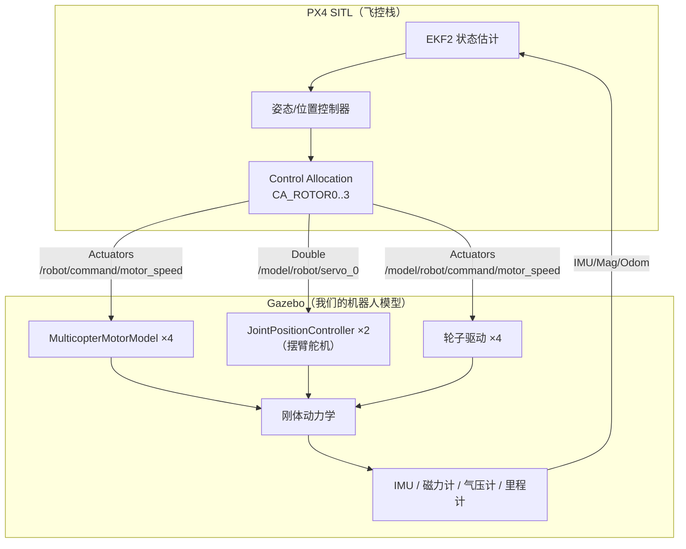

# 陆空机器人 → PX4 移植规格说明书

> 所有接口均从 **PX4 v1.18.0-beta1 源码**确认，非推测。
> 环境：`/home/yuan/PX4-Autopilot`（已编译，SITL 可用）、Gazebo Harmonic 8.15.0

---

## 0. 结论速览

| 项目 | 结论 |
|---|---|
| PX4 能否驱动我们的模型 | **能**，它用的就是我们已经在用的 `MulticopterMotorModel` 插件 |
| 主要工作量 | **改名 + 加传感器 + 写 airframe**，不是重写 |
| 最大障碍 | PX4 **硬编码**了 `base_link` / `servo_0..7` / `imu_sensor` 等名字 |
| 最省力策略 | **照抄 x500**，把我们的几何/质量填进去 |

---

## 1. 架构：PX4 怎么控制我们的机器人



**关键点**：PX4 不走 MAVLink 去驱动 Gazebo，而是 **gz_bridge 直接读写 Gazebo 话题**。MAVLink 只用于外部（地面站/伴飞脚本）给 PX4 下指令。

---

## 2. 话题契约（PX4 源码硬编码，必须严格遵守）

| 方向 | 话题 | 消息类型 | 源码位置 |
|---|---|---|---|
| PX4 → 螺旋桨 | `/<模型名>/command/motor_speed` | `Actuators` | `GZMixingInterfaceESC.cpp:40` |
| PX4 → 舵机 | `/model/<模型名>/servo_<i>` (i=0..7) | `Double` | `GZMixingInterfaceServo.cpp:111` |
| PX4 → 轮子 | `/model/<模型名>/command/motor_speed` | `Actuators` | `GZMixingInterfaceWheel.cpp:46` |
| 模型 → PX4 | `/world/<世界>/model/<模型>/link/base_link/sensor/imu_sensor/imu` | `IMU` | `GZBridge.cpp:228` |
| 模型 → PX4 | `.../link/base_link/sensor/magnetometer_sensor/magnetometer` | `MagneticField` | `GZBridge.cpp:240` |
| 模型 → PX4 | `/model/<模型>/odometry_with_covariance` | `OdometryWithCovariance` | `GZBridge.cpp:254` |
| 通用 | `/world/<世界>/clock`、`/world/<世界>/pose/info` | — | `GZBridge.cpp:204,216` |

### ⚠️ 插件侧的写法（已实测验证）

```xml
<!-- ✅ 正确：照抄 x500。解析结果 = /robot/command/motor_speed，与 PX4 一致 -->
<commandSubTopic>command/motor_speed</commandSubTopic>
<!-- 不要写 robotNamespace！ -->

<!-- ❌ 错误：我们原先的写法。解析结果 = /cmd/motor_speed，PX4 找不到 -->
<commandSubTopic>/cmd/motor_speed</commandSubTopic>
<robotNamespace>/</robotNamespace>
```

**机制**：插件规则是 `命名空间(默认取实体名) + commandSubTopic`。PX4 故意让模型名拼进来，所以**模型名必须 = `PX4_SIM_MODEL` 的值**。

---

## 3. 模型必须做的 6 处改动

### ① 根 link 改名：`base` → `base_link`（**必须**）
IMU/磁力计话题里硬编码了 `link/base_link/`。

### ② 舵机关节改名：`joint1`/`joint2` → `servo_0`/`servo_1`（**必须**）
PX4 源码里是 `"servo_" + std::to_string(i)`，i = 0..7，**没有任何配置项能改**。

### ③ 加传感器到 `base_link`（**必须**，名字固定）

```xml
<sensor name="imu_sensor" type="imu">
  <always_on>1</always_on>
  <update_rate>250</update_rate>
  <topic>imu</topic>
  <gz_frame_id>base_link</gz_frame_id>
</sensor>

<sensor name="magnetometer_sensor" type="magnetometer">
  <always_on>1</always_on>
  <update_rate>100</update_rate>
  <topic>magnetometer</topic>
  <gz_frame_id>base_link</gz_frame_id>
</sensor>

<sensor name="air_pressure_sensor" type="air_pressure">
  <always_on>1</always_on>
  <update_rate>50</update_rate>
  <gz_frame_id>base_link</gz_frame_id>
</sensor>
```

### ④ 电机插件改成 x500 写法 + 重新定标

因为 PX4 把输出直接当 **rad/s** 用（`vel->Add(static_cast<double>(outputs[i]))`，**不做任何缩放**），而 x500 的 `maxRotVelocity = 1000`，所以我们的定标要按 **ω_max = 1000** 重算：

| 参数 | 原值（自研仿真） | **PX4 值** | 依据 |
|---|---|---|---|
| `maxRotVelocity` | 3400 | **1000** | 与 x500 一致 |
| `motorConstant` | 4.325e-7 | **5.0e-6** | $k_T=\dfrac{5.0\ \text{N}}{1000^2}$（TWR=3）|
| `momentConstant` | 2.163e-8 | **2.5e-7** | $k_M = 0.05\,k_T$（你的 0.25 N·m 规格）|
| `rotorVelocitySlowdownSim` | 10 | **10** | 与 x500 一致 |
| `<motorNumber>` | — | **0..3** | x500 用的是 `motorNumber` |
| `turningDirection` | 全 ccw | **见 §4 的 KM 符号** | 关节轴已镜像 |

### ⑤ 舵机控制器改话题（joint1/joint2 → servo_0/servo_1 + 新话题）

```xml
<plugin filename="gz-sim-joint-position-controller-system"
        name="gz::sim::systems::JointPositionController">
  <joint_name>servo_0</joint_name>
  <topic>/model/robot/servo_0</topic>          <!-- PX4 会往这里发 Double -->
  <p_gain>5</p_gain><i_gain>3</i_gain><d_gain>0.2</d_gain>
  <i_max>0.3</i_max><i_min>-0.3</i_min>
  <cmd_max>3.0</cmd_max><cmd_min>-3.0</cmd_min>
</plugin>
<!-- servo_1 同理，话题 /model/robot/servo_1 -->
```

> ⚠️ 注意：这样两个舵机变成**独立话题**，失去了"共享话题强制同步"。
> 同步改由 PX4 侧保证（在 airframe 里把两个舵机映射到同一路输出）。

### ⑥ 轮子：**需要新增一个小插件**（已知缺口）

PX4 往 `/model/robot/command/motor_speed` 发 `Actuators`，但 Gazebo 的
`JointController` 只吃 `Double`。三个选项：

| 方案 | 做法 | 工作量 |
|---|---|---|
| A | 写一个 `Actuators`→关节速度的桥接插件 | 中 |
| B | 用 `MulticopterMotorModel` 但 `motorConstant=0`（只借它设关节速度）| 小，但 hacky |
| C | 伴飞脚本订阅 Actuators 再转成 Double 发出去 | 最小，但多一跳延迟 |

**建议 C**（先用最小代价打通，后期再换 A）。

---

## 4. PX4 airframe 配置

新建 `ROMFS/px4fmu_common/init.d-posix/airframes/4030_gz_airground`

```sh
. ${R}etc/init.d/rc.mc_defaults

PX4_SIMULATOR=${PX4_SIMULATOR:=gz}
PX4_GZ_WORLD=${PX4_GZ_WORLD:=default}
PX4_SIM_MODEL=${PX4_SIM_MODEL:=airground}      # ← 必须和模型名/目录名一致
param set-default SIM_GZ_EN 1

# ===== 控制分配：多旋翼 =====
param set-default CA_AIRFRAME 0
param set-default CA_ROTOR_COUNT 4

# 桨位置（相对重心，已从 URDF 精确计算）
param set-default CA_ROTOR0_PX  0.1008    # 前左
param set-default CA_ROTOR0_PY -0.1100
param set-default CA_ROTOR1_PX  0.1008    # 前右
param set-default CA_ROTOR1_PY  0.1100
param set-default CA_ROTOR2_PX -0.1092    # 后左
param set-default CA_ROTOR2_PY -0.1100
param set-default CA_ROTOR3_PX -0.1092    # 后右
param set-default CA_ROTOR3_PY  0.1100

# 反扭系数：KM = momentConstant/motorConstant = 0.05
#   符号 = 世界坐标下的旋转方向（FL/RR 同向、FR/RL 反向）
#   ⚠ 符号方向必须实测验证，若偏航反向就把四个符号全部取反
param set-default CA_ROTOR0_KM  0.05
param set-default CA_ROTOR1_KM -0.05
param set-default CA_ROTOR2_KM -0.05
param set-default CA_ROTOR3_KM  0.05

# ===== 电机输出映射到 4 个 ESC 功能 =====
param set-default SIM_GZ_EC_FUNC1 101
param set-default SIM_GZ_EC_FUNC2 102
param set-default SIM_GZ_EC_FUNC3 103
param set-default SIM_GZ_EC_FUNC4 104

# ===== 舵机（AUX 通道）=====
param set-default SIM_GZ_SV_FUNC1 201
param set-default SIM_GZ_SV_FUNC2 201        # 两舵机同一路 → 强制同步
```

> ⚠️ `SIM_GZ_EC_FUNC*` / `SIM_GZ_SV_FUNC*` 的具体编号需对照
> `4001_gz_x500` 与 PX4 参数文档再确认（x500 用的是 `SIM_GZ_EC_FUNC1 101`）。

---

## 5. 分阶段实施计划（先易后难）

| 阶段 | 目标 | 验收标准 |
|---|---|---|
| **① 环境** | PX4 SITL + x500 跑通 | ✅ **已完成** |
| **② 模型骨架** | URDF → PX4 格式 SDF，改名 `base_link`，加 IMU/磁力计 | `make px4_sitl gz_airground` 能启动，PX4 收到 IMU 无报错 |
| **③ 电机接通** | 4 个桨改用 x500 写法 + 重新定标 | 手动发 `Actuators` 能看到桨转、能产生升力 |
| **④ 稳定悬停** | 写 airframe，PX4 接管 | **MAVLink 指令 → 稳定悬停 3 米** |
| **⑤ 摆臂舵机** | 改名 `servo_0/1`，接 PX4 AUX | 能给角度指令 |
| **⑥ 轮子** | 桥接 `Actuators` → 关节速度 | 能驱动轮子 |
| **⑦ 空地状态机** | `air_ground_ctrl.py` 改成 MAVLink 版 | 一键切换空地模式 |

**核心原则：④ 之前不要碰舵机和轮子。** 不然出问题分不清是四轴没调好还是空地逻辑有 bug。

---

## 6. 已知坑与对策

| 坑 | 现象 | 对策 |
|---|---|---|
| **gz 库升级后构建失效** | `ninja: error: libgz-transport13.so.13.5.0 missing` | `cd build/px4_sitl_default && cmake .` 重新配置（**已修复，15 秒**）|
| **话题被拼上模型名** | 插件监听 `robotcmd/...`，收不到指令 | 用 §2 的正确写法 |
| **`base_link` 名字硬编码** | IMU 收不到 | 根 link 必须叫 `base_link` |
| **`servo_N` 名字硬编码** | 舵机没反应 | 关节必须叫 `servo_0`..`servo_7` |
| **PX4 假设机架刚性** | 摆臂一动，控制分配失效 | **飞行时臂锁 0°**（正好符合我们的设计）|
| **重心随摆臂移动** | 48° 时重心偏移很大 | 同上 |
| **turningDirection 语义** | 转向配错 → 越飞越打转 | 我们的 `rot_check.py` 可直接复用验证 |
| **ma 中游 gz 进程冲突** | 话题污染、模型闪烁 | 每次只跑一个仿真实例 |

---

## 7. 快速参考

### 关键数值（已从 URDF 精确计算）
```
整机质量       679.86 g          重力 6.67 N
重心(机身系)   (-0.0578, 0.0000, +0.0133)
桨高           z = +0.0548       （重心上方 4.15 cm —— 摆式安定性偏弱）
轮心           z = +0.0030

桨相对重心：
  FL (+0.1008, -0.1100)   FR (+0.1008, +0.1100)
  RL (-0.1092, -0.1100)   RR (-0.1092, +0.1100)
```

### 关节规格（不变）
| 关节 | 新名字 | effort | velocity |
|---|---|---|---|
| joint1/2 | **servo_0 / servo_1** | 0.7 N·m | 13 rad/s |
| joint3~6 | 不变 | 0.25 N·m | 3400 rad/s |
| joint7~10 | 不变 | 15 N·m | 50 rad/s |

### 常用命令
```bash
# 启动 PX4 + 我们的模型（无界面）
cd /home/yuan/PX4-Autopilot
PX4_GZ_HEADLESS=1 make px4_sitl gz_airground

# MAVLink 端口
#   GCS      : udpout:127.0.0.1:18570
#   Offboard : 本地 14580 → 远端 14540

# 构建缓存失效时的修复
cd /home/yuan/PX4-Autopilot/build/px4_sitl_default && cmake . && cd ../.. && make px4_sitl
```

---

## 8. 下一步可以立刻做的（不依赖 PX4 改配置）

1. **建立模型目录**：`Tools/simulation/gz/models/airground/`
   ```
   model.config          # 声明模型名、作者、SDF 版本
   model.sdf             # 由 robot.urdf 转换 + 手工改名字/加传感器
   meshes/               # 从 robot_urdf (4)/meshes 复制
   ```
2. **URDF → SDF 转换**：`gz sdf -p robot.urdf > model.sdf`（已验证可用）
3. **写改名脚本**：`base`→`base_link`、`joint1/2`→`servo_0/1`、
   `MulticopterMotorModel` 参数按 §3④ 替换
4. **airframe 脚本**：按 §4 写 `4030_gz_airground`
